<div align="center">


# MacPilot

**Your AI copilot for the Mac — assistant, meetings, notes, tasks, clipboard and launcher in one native menu bar app.**


[**⬇ Download MacPilot 0.33.4 (.dmg)**](releases/MacPilot-0.33.4.dmg) · [What's new](#whats-new) · [Features](#features) · [Agent](#ai-agent) · [Telegram](#telegram-bot) · [Jobs](#scheduled-jobs) · [Job finder](#job-finder) · [Computer use](#computer-use) · [Smart reminders](#smart-reminders) · [Memory](#memory-and-open-loops) · [Focus](#smart-do-not-disturb) · [Search](#universal-search) · [Ports](#port-killer) · [Cleanup](#developer-cleanup) · [Updates](#auto-updates) · [Network & CPU](#network-speed-and-speed-test) · [Finder convert](#finder-convert-with-macpilot) · [Floating buddy](#-floating-buddy) · [First run](#first-run) · [Install](#install) · [Build from source](#build-and-run) · [Shortcuts](#default-shortcuts)

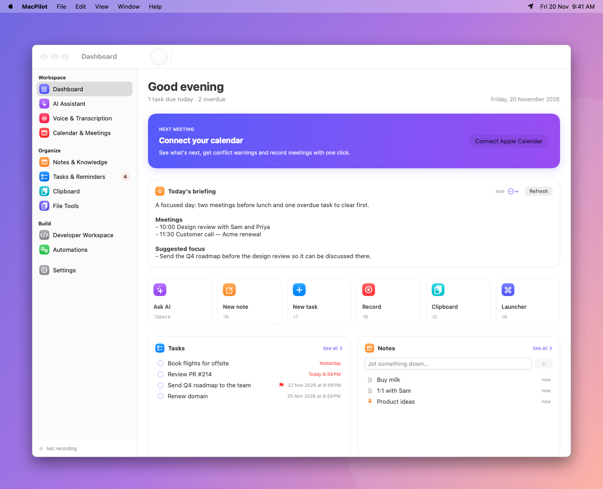

</div>

MacPilot brings Raycast-style speed and an AI assistant to everything you do on a Mac: ask Claude (Anthropic or Amazon Bedrock), OpenAI or a local Ollama model from anywhere, record and summarize meetings, dictate into any app, manage notes, tasks and your calendar, search your clipboard, convert files, and sync it all between your Macs — with a friendly floating buddy on your desktop and live status in the MacBook notch. **Bring your own keys** — there is no MacPilot account or server; data stays on your Mac and credentials in the Keychain. Cloud features send only the relevant content to the provider you choose.

## What's new

**0.33.3** — Agent chats
- 💬 The Agent tab is now a list of **chats**: replying in a chat continues it, and the agent sees the earlier messages, tool calls and answers (trimmed to fit). **New chat** (⌘N) starts fresh; right-click to rename. The view stays on your chat when tasks finish. On Telegram, messages continue your current chat; `/new` (or 30 minutes of quiet) starts a new one.

**0.33.1** — the agent uses Bedrock when that's what you set up
- 🔧 With Claude via Amazon Bedrock configured, the agent no longer asks for an Anthropic key: it picks the provider you actually set up (your default, then Bedrock, Anthropic, OpenAI, Ollama). A provider you picked yourself is never switched; if it has no credentials you get a one-click “use Claude (Bedrock) instead?”. Labels now read **Claude (Bedrock)** and **Claude (Anthropic API)**.

**0.33** — network speed and CPU beside the notch
- 📶 **Live ↓/↑ speed and CPU % beside the notch**, on by default: network on the left, CPU on the right (orange above 80%), steady monospaced digits. It steps aside for recordings, timers, music and alerts, then comes back. On Macs without a notch it goes in the menu bar (network, CPU or both). Click it for 60-second graphs, per-core bars, memory, the top 5 processes and a speed test. Settings → Notch: separate toggles, units (Auto / MB/s / Mbps) and 1 s or 2 s updates. Sampling costs about 0.01% CPU and pauses while the screen is locked or asleep.

**0.32** — developer cleanup
- 🧹 **See how much space developer files take and free it safely:** Developer → Cleanup (and a “12.4 GB reclaimable” dashboard card) finds node_modules in your project folders, Xcode DerivedData, old Archives, iOS DeviceSupport, simulator caches and unavailable simulators, Docker leftovers, and npm/Yarn/pnpm/pip/Homebrew/CocoaPods/Gradle caches. Everything goes to the Trash after a confirmation; only caches can be deleted permanently. ⌥K “how much can I free?”, Telegram `/cleanup`, and an optional monthly reminder.

**0.31** — first-run setup
- 🧭 A guided setup on first launch: pick your AI provider (key saved to the Keychain, or find Ollama), grant permissions with live ✓ status, connect calendars, choose features (buddy, notch, Smart DND, Memory, open at login), pair Telegram and turn on updates. Skip anything; quitting resumes where you were. Reopen it from Settings → General, the menu bar or ⌥K “Setup”.

**0.30** — auto-updates
- ⬆️ MacPilot keeps itself up to date: it checks daily (Sparkle 2) and installs a new version when you click **Install Update** — or automatically, if you turn that on. **Check for Updates…** is in the menu bar, ⌥K and Settings → General; Telegram `/version` tells you if one is waiting.

**0.29** — port killer
- 🔌 **See what's listening and free a port:** Developer → Ports (and a dashboard card) lists every listening TCP/UDP port with the app, PID, user, command and project folder, refreshing live, with quick chips for :3000, :5173, :8080, :5432 and :6379.
- ✋ **Stop safely:** always asks first, sends SIGTERM, and only offers Force kill if it's still running after 3 seconds. System processes, other users' processes and MacPilot itself are protected (no sudo). Also from ⌥K (“kill port 3000”, “what's on port 5432”), Telegram `/ports` and `/killport`, and the agent.

**0.28** — Smart Do Not Disturb and universal search
- 🌙 **Smart Do Not Disturb:** Focus turns on by itself in meetings, on calls, while you share your screen, or during deep work in Xcode (or apps you pick) — and back off afterwards, with a grace period between back-to-back meetings. MacPilot holds its own alerts and gives you one summary afterwards. “Focus for 25/50 min” and **Not now** are one tap away in the menu bar, the notch, ⌥K and Telegram `/focus`.
- 🔎 **Universal search (⌥F):** one box for notes, meeting transcripts, memory and open loops, snippets, clipboard, tasks, reminders, agent history, files, Mail, Gmail and your calendar — with filters like `in:mail from:sam after:7d`, quick actions, and **Tab** for an answer with citations. Also from ⌥K by typing `?` or `/`.

**0.27** — memory and open loops (opt-in)
- 🧠 **Memory, off by default:** turn it on and pick apps (Mail, Messages, Slack, Notes…). MacPilot remembers the visible text of those windows — read locally through Accessibility, never screenshots — in a searchable database on your Mac, with retention, “Forget app” and “Delete everything”.
- 🔁 **Open loops:** what you promised (“I'll send the deck Friday”) and what you were asked (“can you review X?”), with who, due date and the source snippet. Done, Snooze, Dismiss or **Remind me**; due dates can become smart reminders, and loops that look finished are marked for a one-tap confirm.
- 🔌 Ask the agent, Pilot (“what did I promise this week?”) or Telegram `/loops`, and optionally connect other AI apps through a **local MCP server** (stdio, or HTTP on 127.0.0.1 with a token).

**0.26** — smart reminders
- 🔔 **Reminders that fire on context, not just time:** when you open or quit an app, join or leave a Wi-Fi network, wake or unlock the Mac, arrive at or leave a place, or a few minutes before your next meeting — plus ordinary and recurring times.
- 🗣 Say or type it in plain words — Agent → Reminders, ⌥K “Remind me…”, Pilot (“remind me to check PR reviews when I open Xcode”) or Telegram `/remind`. You confirm “When you open Xcode → ‘Check PR reviews’” before it's saved.
- ✅ Delivered as a notification with **Snooze / Until next time / Done**, in the notch, and in Telegram with the same buttons. Limits like “on weekdays”, “between 9 and 5”, once vs. every time, and cooldowns keep them from nagging. Location and Wi-Fi names never leave the Mac.

**0.25** — computer use
- 🌐 **The agent's own browser:** opens pages, reads them (text plus clickable elements), clicks, types, selects, scrolls, waits and takes screenshots — in a separate, non-persistent browser that never sees your Safari or Chrome logins. Sites outside your allowlist, form submits and password or payment fields always ask first.
- 🖱 **Control Mac apps** through Accessibility: list apps and windows, read an app's controls, click, type, press keys and take screenshots, in apps you allow (others ask; System Settings, Keychain Access, password managers and the login window are never touched).
- 🔒 **Pauses when the Mac is locked:** GUI and browser steps wait until you unlock; file and command steps continue. Queued tasks resume after a restart, and the job finder now keeps the same role in different regions.

**0.24** — scheduled jobs and a job finder
- ⏰ **Scheduled jobs** (Agent → Jobs): run the agent daily, weekly, every N hours or on a cron schedule in your time zone — e.g. a price watch that emails you when the price changes. Pause, resume, run now, edit; run history; missed runs catch up once after a restart.
- 💼 **Job finder:** new postings from the public Greenhouse, Lever and Ashby job boards of companies you choose (30 to start), RSS feeds and your own LinkedIn/Indeed alert emails, filtered by keywords, location/remote, level and excluded words, deduplicated, and emailed grouped by company — only what's new.
- ✉️ **Email from Mail or Gmail**, approved once per job for one exact recipient and sender. 🌐 **Web tools** (search, fetch page, extract) that honor robots.txt and treat page content as untrusted. Telegram: `/jobs` and `/newjob`.

**0.23** — control the agent from Telegram
- 📱 **Telegram bot:** pair your phone with a one-time code, then send requests from Telegram; the agent runs them on your Mac and edits one progress message as it goes, ending with a summary.
- ✅ **Approve from your phone:** risky steps arrive with **Approve once / Deny** buttons that only you can use, once, within 10 minutes.
- 🖥 **/screenshot**, **/status**, **/tasks**, **/cancel**, **/model** — with the kill switch and local-only mode still in charge. No open ports: MacPilot polls Telegram.

**0.22** — the AI Agent (core)
- 🤖 **Agent tab:** ask for multi-step work ("find the TODOs in my project and collect them in TODO.md", "run the tests and tell me what fails"). The agent reads, searches and writes files in **workspace folders you choose**, runs **allowlisted commands**, and checks system status, with a live timeline of every tool call.
- 🛡 **Policy outside the AI:** reads run freely; writes and commands ask first (configurable); deletes always ask for the exact path. Approvals are one-time, tied to the exact action and task, and expire after 10 minutes. Secrets are redacted from the database and logs.
- ⏹ **Stop, Retry and a kill switch** in the menu bar that halts the running command and every future tool call within two seconds. Per-task and daily cost caps, step/time/token limits, and a **local-only mode** that blocks cloud providers. ⌥K → “Ask agent…”.

**0.21** — network speed, Finder convert, meetings that record themselves
- 📶 **Live network speed:** ↓/↑ throughput in the notch (optional compact readout, plus a 1-minute graph when expanded), a dashboard card with a graph, interface and local IP, and an optional menu bar readout.
- 🚀 **Speed test:** download, upload and latency with macOS's own `networkQuality`, with progress and the last 20 results. Run it from the dashboard, ⌥K → “Speed test”, the notch, or say *“run a speed test”* to Pilot.
- 🗂 **Finder → right-click → Convert with MacPilot:** pick a conversion that fits the selected files (several at once); results are saved next to the originals. Parked files on the notch shelf have **Convert…** too.
- 🔴 **Meeting auto-record:** choose Off, All meetings, Meetings with a video link, or Selected calendars, and switch single meetings on or off. A notch alert with **Stop** appears when recording starts, with an optional reminder to tell attendees. Past events show a recorded badge with **Recording · Transcript · Summary** links, and a **Recorded** filter shows only those.

**0.20** — several Google accounts
- 📅 Connect **as many Google accounts as you like** (personal, work, clients…). Every calendar from every account shows up together, grouped by account, each with its own show/hide toggle; create and edit events in any of them.

**0.19** — Pilot talks back, and a file shelf in the notch
- 🗣 **Talk to Pilot:** click the buddy (or say **“Hey Pilot”**) and speak. It answers out loud with an on-device voice and runs commands: “add a task call mom tomorrow at 5”, “what's next today?”, “start recording”, “set a timer for 25 minutes”, “new note …”, “open my calendar” — anything else goes to your AI.
- 📥 **Notch file shelf:** drag files onto the notch to park them, then drag them out into any app, AirDrop them, or ask AI about them.

**0.18** — the floating buddy
- 🤖 **Pilot**, an animated desktop helper: click to ask AI; buttons for voice note, dictation and new note; ⋯ for Ask my Mac, screenshot, clipboard and launcher. Reacts while you dictate or record.
- **×** on hover hides it; bring it back from the menu bar (“Show Floating Buddy”), ⌥K or Settings. The menu always shows the current Show/Hide state.
- 🚀 **Opens at login** so everything is ready after a restart (toggle in Settings → Shortcuts → Startup or the menu bar).

**0.15 – 0.17**
- ✨ AI on selected text (⌥⇧E), Ask my Mac (⌥⇧A), screenshot & OCR (⌥⇧S), screen-aware ⌥Space, your own AI commands
- 🌅 Morning briefing, one-click meeting follow-up, PDF page editor, snippets and quick links
- ☁️ iCloud sync between Macs, hidden from screen sharing

## Features

### ✨ AI everywhere

| AI on selected text (⌥⇧E) | Ask my Mac (⌥⇧A) |
|---|---|
| 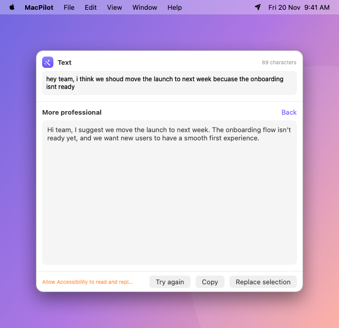 | 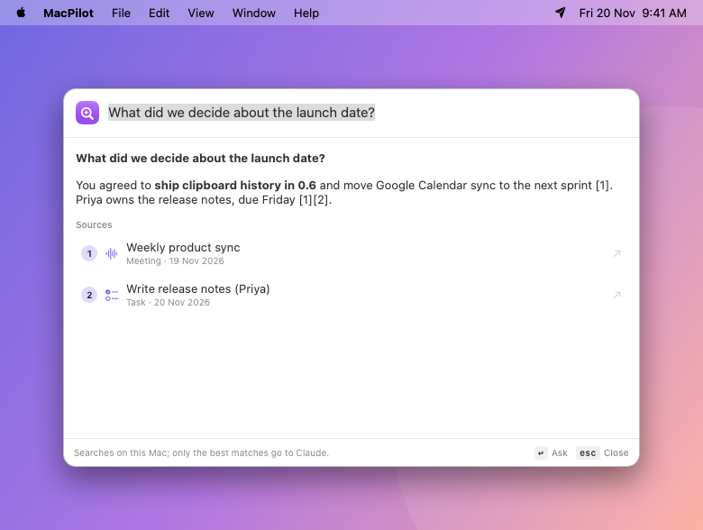 |
| Select text in any app → fix grammar, rewrite, shorten, change tone, bullets, summarize, explain, reply, translate — or your own AI command. Return replaces the selection. | Ask questions across your meetings, notes, tasks and clipboard. Ranked on-device; the answer cites numbered sources you can open. |
| **Assistant from anywhere (⌥Space)** | **Screenshot & read text (⌥⇧S)** |
| 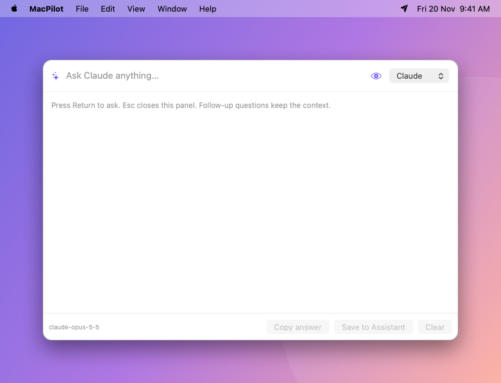 | 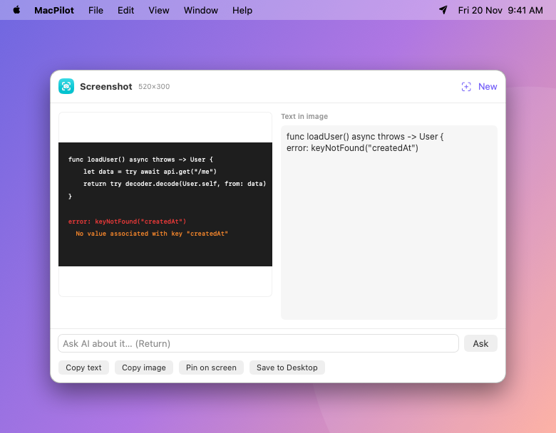 |
| Floating chat with Claude (Anthropic or Bedrock), OpenAI or Ollama. The 👁 button reads the window you were using: “summarize this”, “explain this error”. | Capture an area like ⌘⇧4, read its text (OCR), ask AI about it, copy, save, or pin it on screen. |
| **AI chat with history & prompt library** | **Morning briefing, light & dark** |
| 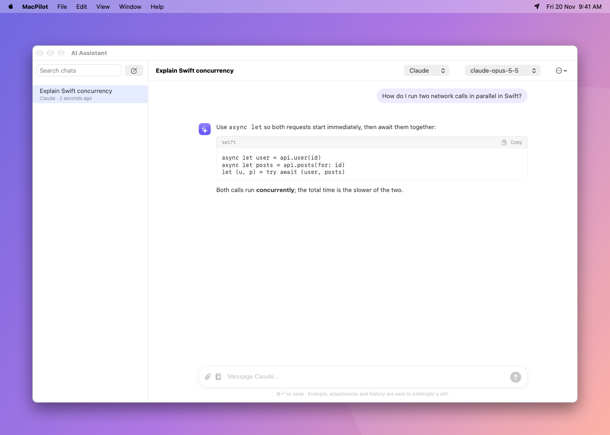 | 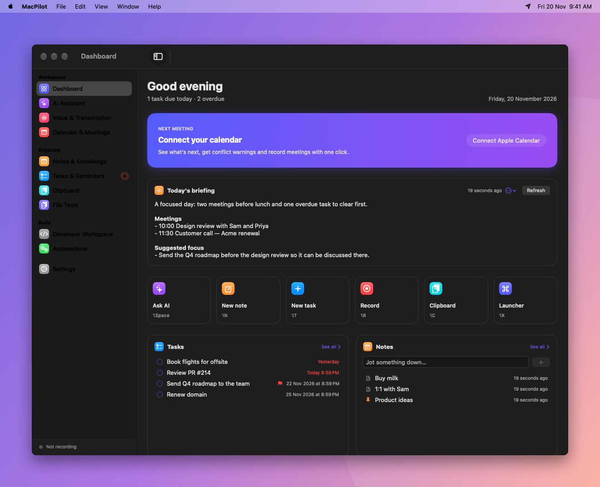 |
| Full chat window with streaming, code blocks, attachments, saved prompts and per-chat model choice. | The dashboard opens with an AI summary of today's meetings, due/overdue tasks and open action items, plus a suggested focus. |

### 🤖 Floating buddy that talks back

| Talk to Pilot | States |
|---|---|
| 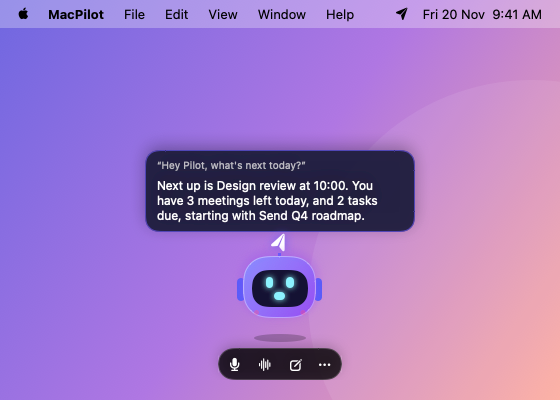 | 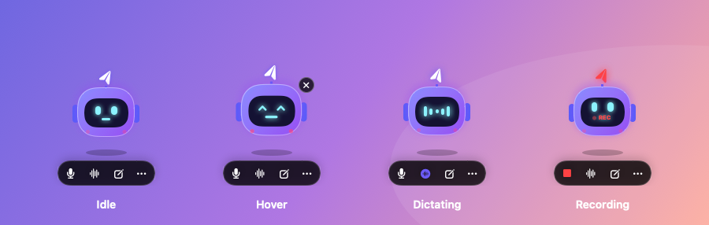 |

**Pilot**, MacPilot's little desktop helper, floats above your windows. **Click it (or say “Hey Pilot”) and speak**: it shows what it heard, answers out loud with an on-device voice, and can act for you — *“add a task call mom tomorrow at 5”*, *“what's next today?”*, *“start recording”* / *“stop recording”*, *“take a voice note”*, *“set a timer for 25 minutes”*, *“new note buy a gift for Sam”*, *“open my calendar”*, *“run a speed test”*, *“dictate”*. Anything else is answered by your AI in a sentence or two, and follow-up questions keep the context. Its buttons record a **voice note**, start **dictation** into the app you're using, or open a **new note**; ⋯ adds Ask my Mac, screenshot, clipboard and launcher. It blinks while idle, smiles when you hover, shows a live waveform while you dictate and a red REC light while recording. Drag it anywhere (it remembers the spot) and right-click for more. To remove it, hover and click its **×** button (or use the menu bar, ⌥K or **Settings → Shortcuts**); bring it back from any of those. Like every MacPilot window, it's hidden from screen sharing.

### 🎙 Meetings, voice and calendar

| Recording, transcripts & meeting intelligence | One-click follow-up |
|---|---|
| 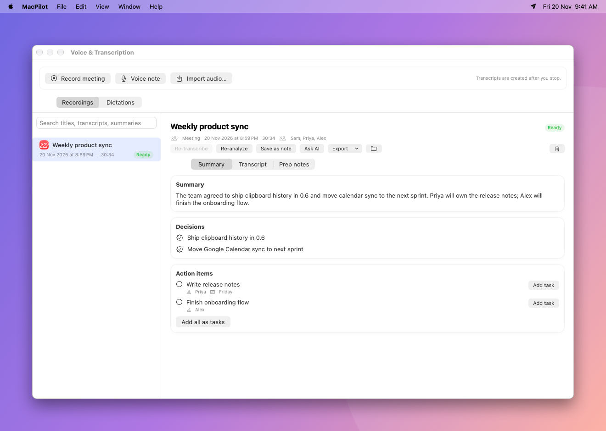 | 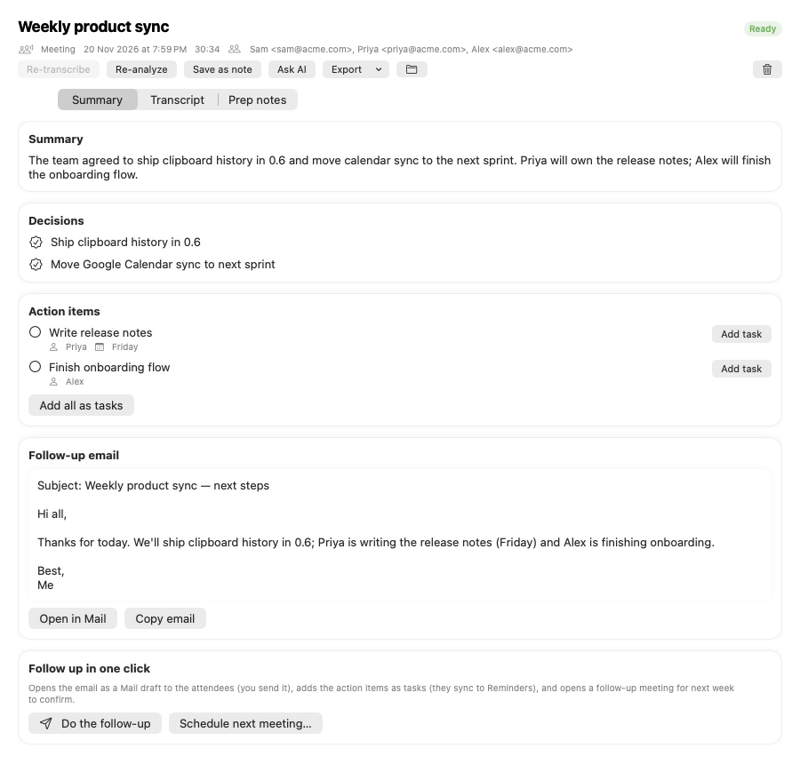 |
| Record mic + system audio (optionally the screen as video). Transcribe with Amazon Transcribe, OpenAI or on-device Whisper, with speakers, live captions and subtitle export. Get a summary, decisions, action items and a follow-up email. | Open the follow-up as a Mail draft to the attendees, turn action items into tasks (synced to Reminders), and schedule the next meeting. |
| **Calendar (Apple + several Google accounts)** | **Notes** |
| 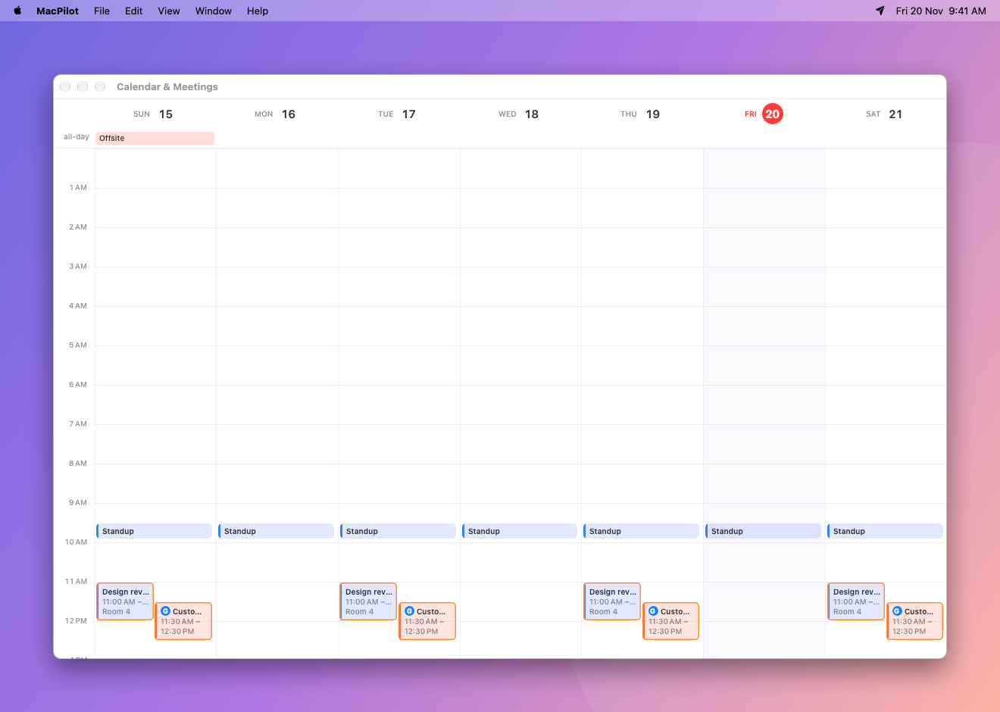 | 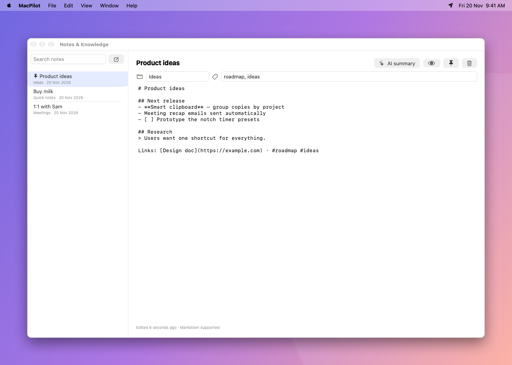 |
| Week and day views across Apple Calendar and any number of Google accounts, conflict warnings, natural-language quick add (“lunch with Sam tomorrow 1pm”), meeting prep notes and “record this meeting”. | Markdown notes with folders, tags, pins, AI summaries and notes created from meetings. **⌥N** from anywhere. |
| **Tasks & Reminders** | **Dictation (⌥D)** |
| 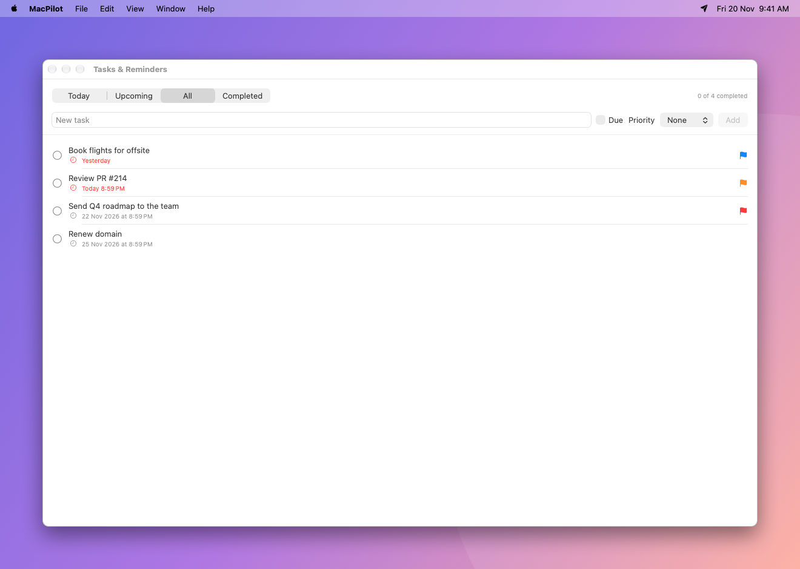 | 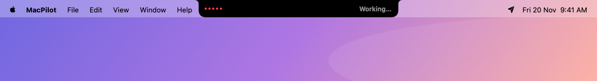 |
| Due dates, priorities, recurring tasks and notifications, with two-way Apple Reminders sync. **⌥⇧T**: say a task and it's added. | Hold ⌥D and talk; release to paste clean text at the cursor in any app. Styles for messages, email and code. |

### 🟣 The notch

MacPilot turns the MacBook notch into a live status area. Hover or click it to expand.

| File shelf: drop files on the notch | Expanded |
|---|---|
| 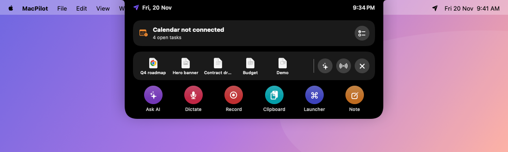 | 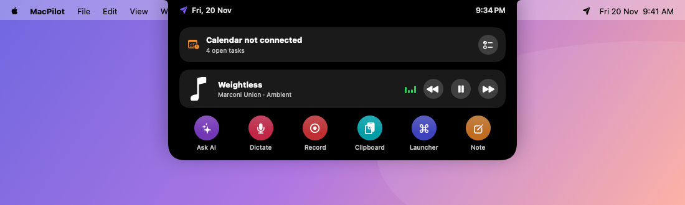 |
| **Recording** | **Meeting about to start** |
|  |  |
| **Now playing (Music / Spotify)** | **Dictation** |
| 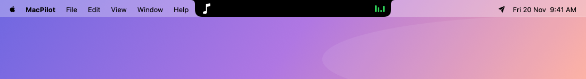 |  |

**File shelf:** drag files from Finder (or anywhere) toward the notch — it opens as a drop zone. Parked files stay there (only a reference; the files don't move) until you drag them out into Mail, Slack, a browser upload or any app. Double-click opens one; right-click for Ask AI, AirDrop, Show in Finder and Remove; the shelf's buttons ask AI about all of them, AirDrop all or clear it. Turn it off in **Settings → Recording & Calendar → Notch**.

Expanded: date and time, next meeting with **Join** and **Record**, open tasks, now playing with playback controls, quick timers (“25m focus”), and one-tap buttons for Ask AI, Dictate, Record, Clipboard, Launcher and Note. On Macs without a notch it shows as a small pill under the menu bar.

**Multiple Google accounts:** connect personal, work and client accounts side by side. Each account lists all its calendars (shared and subscribed ones too) with show/hide toggles; a calendar shared between two of your accounts appears once.

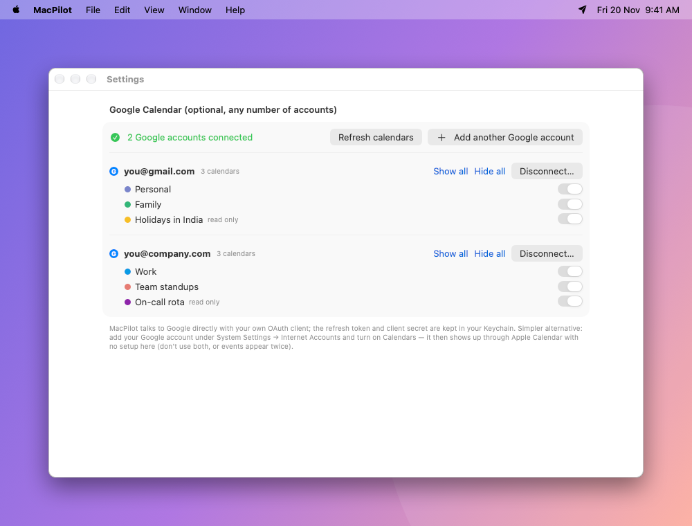

### 📶 Network speed and speed test

Live ↓/↑ throughput sampled once a second from the network interface counters (no traffic is generated, barely any CPU): a compact readout next to the notch, a 60-second sparkline when the notch is expanded, a dashboard card with a graph, the active interface (Wi-Fi, Ethernet…) and local IP, and an optional menu bar readout. **Speed test** runs macOS's built-in `networkQuality` for download, upload and latency and keeps the last 20 results.

### ⚡ Raycast-style tools

| Command launcher (⌥K) | Clipboard history (⌥C) |
|---|---|
| 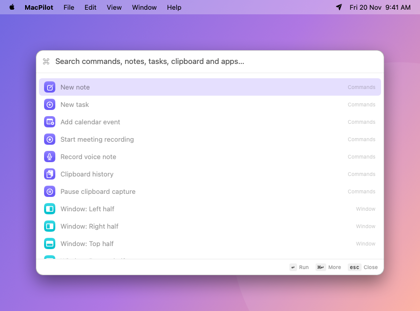 | 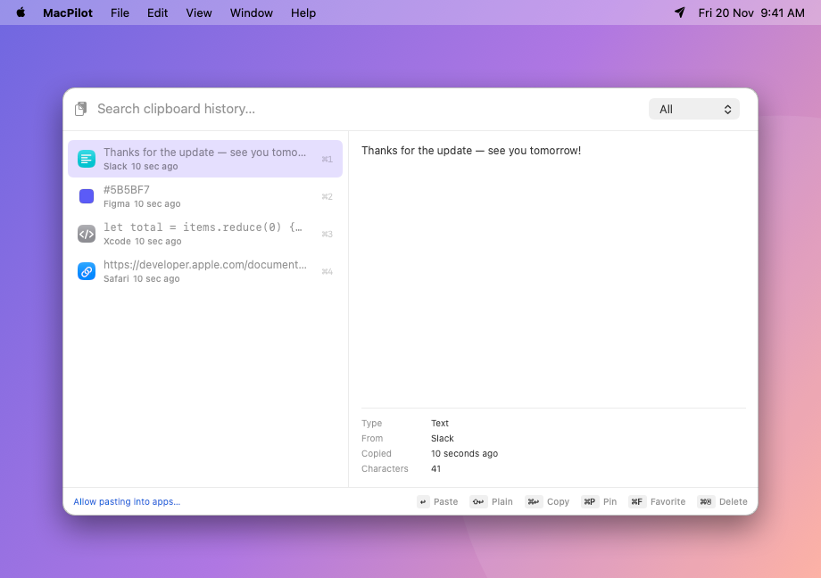 |
| Apps, files, calculator and unit conversions, window management, system commands, quick links (`jira 123`, `yt lofi`), snippets and your AI commands. Learns what you use. | Text, links, images, files and colors with fuzzy search, pins, favorites and paste-into-app. Password managers and secrets are never saved. |
| **Clipboard library** | **Snippets, quick links & AI commands** |
| 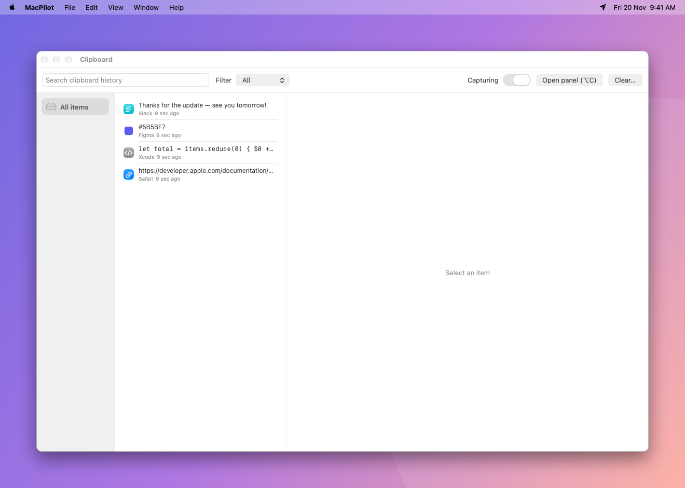 | 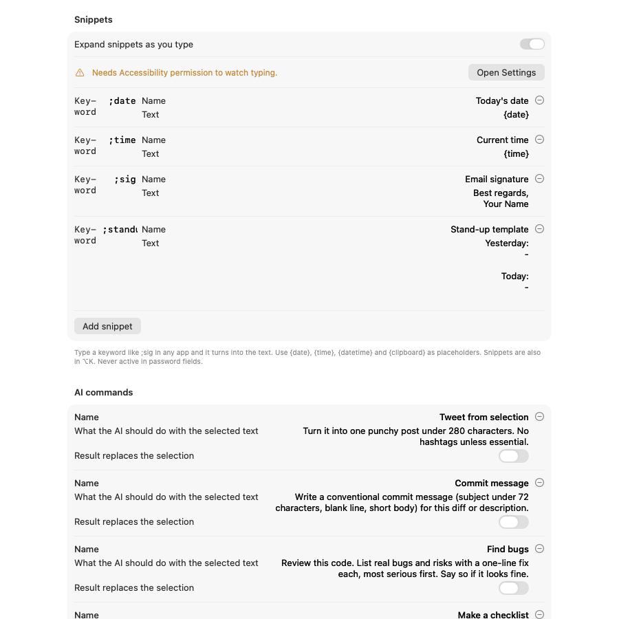 |
| Full history with folders, retention rules and AI actions: explain, summarize, fix grammar, translate, format JSON. | Type `;sig` or `;date` anywhere to expand it. Save prompts like “Commit message” or “Find bugs” as commands. |

### 📄 Files, developer tools and sync

| PDF page editor | File converters |
|---|---|
| 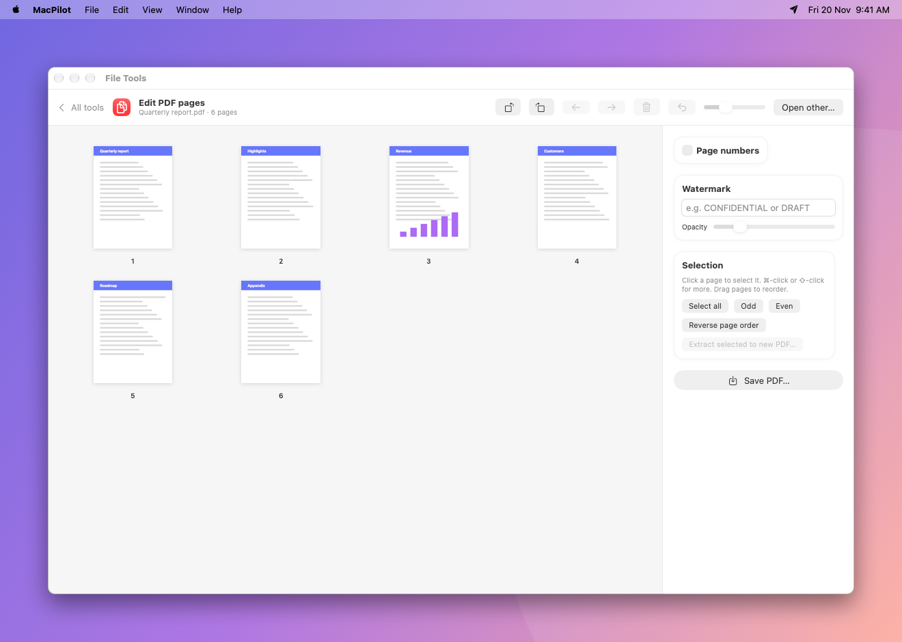 | 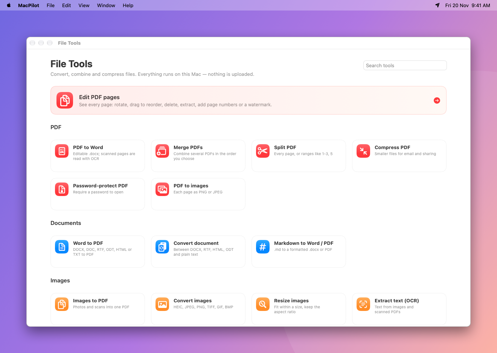 |
| Rotate, drag to reorder, delete, duplicate, extract, add page numbers and a watermark, with undo. | PDF ↔ Word, merge, split, compress, password-protect, PDF ↔ images, HEIC/PNG/JPEG conversion, resize, OCR, video → MP4, extract audio. All on-device. |
| **Developer workspace** | **iCloud sync between your Macs** |
| 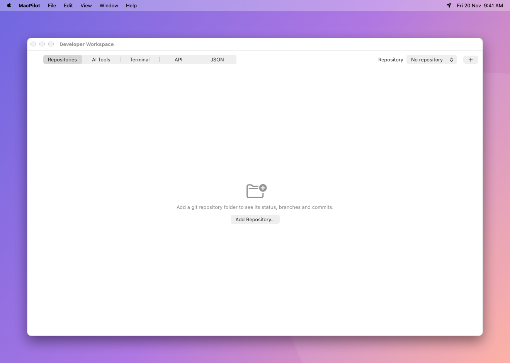 | 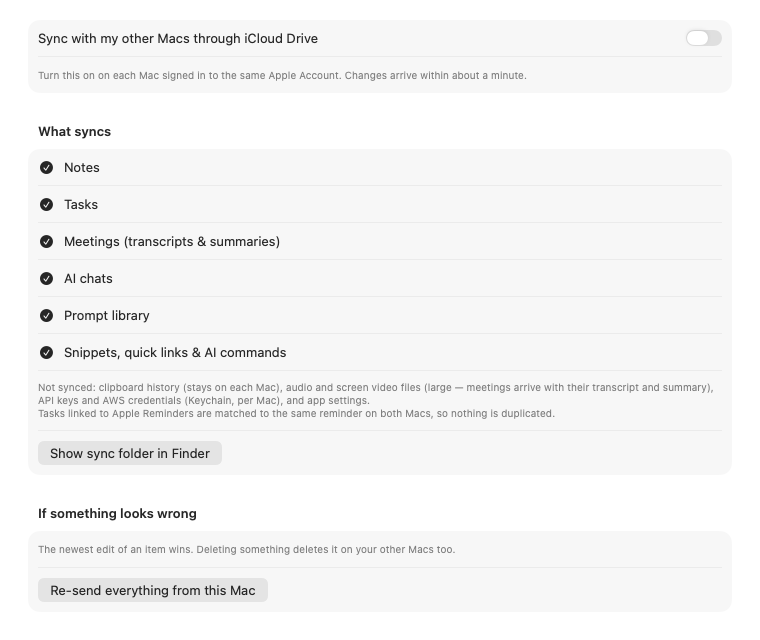 |
| Git status and AI commit messages, JSON/YAML formatter, regex tester, JWT and Base64 decoders, UUIDs, timestamps and color tools. | Notes, tasks, meetings, chats, prompts, snippets and AI commands sync through iCloud Drive. Tasks linked to Reminders never duplicate. |
| **Settings: bring your own keys** | |
| 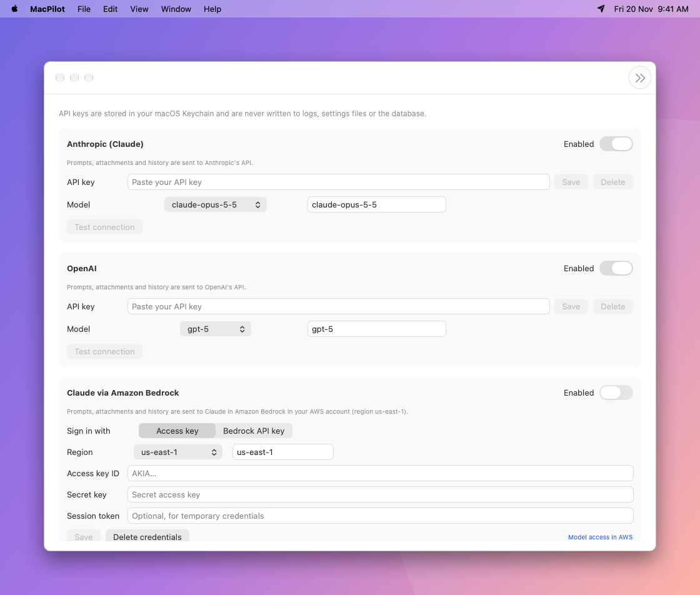 | Anthropic, OpenAI, **Claude on Amazon Bedrock** (access key or Bedrock API key), Amazon Transcribe with automatic S3 setup and cleanup, Ollama and local Whisper. Keys live in the Keychain, and every shortcut can be changed. |

**Also included:** automations (triggers → actions with approvals and run history), usage and cost tracking per provider, export to Markdown/SRT/MP4, and windows that stay **hidden from screen sharing and screen recordings**.

> **About these screenshots:** they're rendered from MacPilot's real SwiftUI screens with sample data, inside a real macOS window frame on a generated desktop (`SNAPSHOT_DIR=docs/screenshots/mac swift test --filter testRenderMacScreens`). Live blur isn't captured, so floating panels show a plain background instead of the frosted glass you see on screen.

## First run

On first launch (and when a newer version adds setup steps) MacPilot opens **Set up MacPilot**:

| Welcome | Permissions, with live status |
|---|---|
| 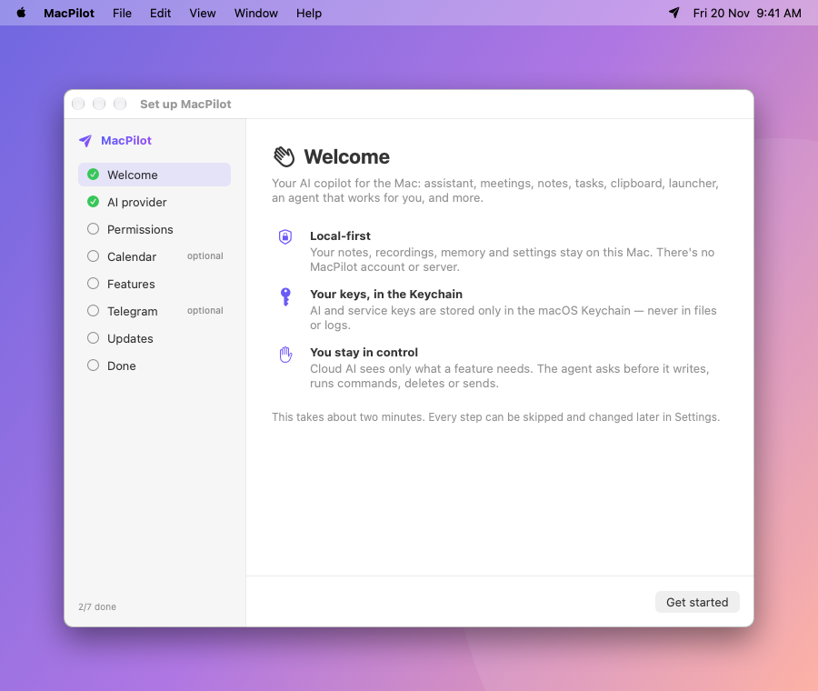 | 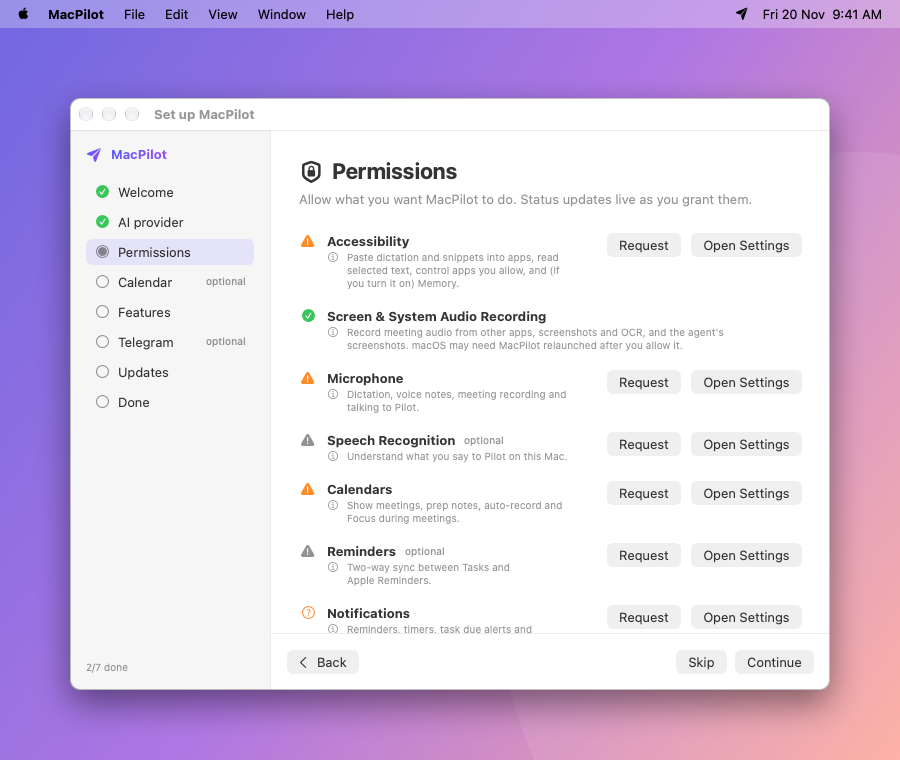 |

1. **Welcome** — what MacPilot does and the privacy promise: local-first, keys in the Keychain, you approve what the agent does.
2. **AI provider** — Anthropic, OpenAI, Amazon Bedrock or Ollama. Keys go straight to the Keychain; **Test connection** checks them; Ollama is found automatically on this Mac.
3. **Permissions** — Accessibility, Screen & System Audio Recording, Microphone, Speech Recognition, Calendars, Reminders, Notifications, and optional Location, Automation → Mail and Full Disk Access. Each shows ✓ / ⚠, a one-line “why”, **Request** and **Open Settings**, and updates every 2 seconds. macOS often applies Screen Recording only after a restart — **Relaunch MacPilot** brings you back to the same step.
4. **Calendar** — Apple Calendar access and, optionally, Google accounts.
5. **Features** — floating buddy, notch, Smart Do Not Disturb (with the Focus shortcuts setup), Memory (off by default) and open at login.
6. **Telegram** (optional) — BotFather steps, the token (Keychain) and pairing your phone.
7. **Updates** — automatic checks and **Check now**.
8. **Done** — what's set up, what was skipped (each with a link to the right Settings tab) and the shortcuts to try first: ⌥K, ⌥F, ⌥Space, ⌥D.

Every step can be skipped, you can go back and forth (Return continues, ⌘[ goes back), and progress is saved after each step. Until the required steps are done, the dashboard shows **Setup: 5/7 done** with **Continue setup**. Reopen it any time from **Settings → General → Run setup again**, the menu bar (**Setup…**) or ⌥K **Setup**.

## Install

1. [Download `MacPilot-0.33.4.dmg`](releases/MacPilot-0.33.4.dmg) (universal: Apple silicon and Intel, macOS 14+).
2. Open it and drag **MacPilot** into **Applications**.
3. The build is ad-hoc signed (not notarized), so the first launch needs one approval: right-click MacPilot → **Open** → **Open**, or **System Settings → Privacy & Security → Open Anyway**. If macOS still refuses:
   ```bash
   xattr -dr com.apple.quarantine /Applications/MacPilot.app
   ```
4. MacPilot lives in the menu bar and **opens automatically when you log in** (turn that off in **Settings → Shortcuts → Startup** or the menu bar's “Open at Login”; macOS also lists it under System Settings → General → Login Items).
5. Add an API key (Anthropic, OpenAI or AWS) in **Settings → Providers**, and grant Microphone, Accessibility and Screen Recording when you use features that need them.

SHA-256 of the DMG: `27f9378ed80878967cf71858cd2b5083bd9e9e8f577d83582e28b36940e6cb49`

## Status

| Phase | Scope | Status |
|---|---|---|
| 1 | Native app, menu bar, dashboard, shortcuts, settings, Keychain | Done |
| 2 | OpenAI + Claude streaming chat, history, prompt library | Done (plus Ollama and Bedrock) |
| 3 | Microphone recording, dictation, transcription, transcript editor | Done, with ⌥D push-to-talk dictation |
| 4 | Meeting recording, system audio, screen video, meeting intelligence | Done, with live captions on Amazon Transcribe |
| 5 | Calendar, notes, tasks, reminders | Done (Apple + Google Calendar, two-way Reminders) |
| 6 | Clipboard manager, launcher, developer workspace | Done |
| 7 | Automations, local Whisper, distribution | Done (ZIP/DMG packaging) |
| 8 | AI everywhere: text actions, Ask my Mac, screenshots, briefing, AI commands | Done |
| 9 | File tools, PDF page editor, iCloud sync, notch | Done |
| 10 | Floating buddy, open at login, hidden from screen sharing | Done |
| 11 | Voice buddy (“Hey Pilot”, spoken answers, voice commands), notch file shelf | Done |
| 12 | Multiple Google accounts with all their calendars | Done |

## Requirements

- macOS 14 Sonoma or later (Apple silicon or Intel)
- Xcode 15.3+ or the matching Command Line Tools (Swift 5.10+)

## Build and run

```bash
./scripts/build-app.sh          # release build -> build/MacPilot.app
open build/MacPilot.app
```

You can also open `Package.swift` in Xcode and run the `MacPilot` scheme for debugging. Running the bare binary (`swift run`) works too, but task notifications are disabled outside a bundled `.app`.

Run the test suite with `swift test`.

On first launch the dashboard opens on **Settings → Providers**. Save an Anthropic or OpenAI key to test the connection and load available models. For Ollama, enable the provider and enter your server URL (default `http://localhost:11434`). Choose your default chat, transcript analysis, and audio transcription providers in **Settings → Routing**.

### Installing on another Mac

1. Run `./scripts/package.sh` to create `build/MacPilot-<version>.zip` and `build/MacPilot-<version>.dmg`. The script attempts a universal build for Apple silicon and Intel and prints the architectures it packaged. If the universal build fails, it retries for the build Mac's architecture. Share the ZIP or DMG to preserve the app bundle's permissions and structure.
2. On the other Mac, unzip (or open the dmg) and drag **MacPilot** into **Applications**.
3. The default build is not signed with an Apple Developer ID, so macOS blocks the first launch. Allow it once, either:
   - double-click MacPilot, then **System Settings → Privacy & Security**, scroll down and press **Open Anyway**; or
   - in Terminal: `xattr -dr com.apple.quarantine /Applications/MacPilot.app`
4. Open MacPilot. It lives in the menu bar (paper-plane icon); there is no Dock icon until you open the dashboard.

Set `BUILD_DIR=build/release` before running the packaging script to keep a separate set of output files.

For installs that open with no warning, sign with a Developer ID certificate (paid Apple Developer Program) and notarize:

```bash
xcrun notarytool store-credentials macpilot --apple-id you@example.com --team-id TEAMID
SIGN_IDENTITY="Developer ID Application: Your Name (TEAMID)" NOTARY_PROFILE=macpilot scripts/package.sh
```

### Claude via Amazon Bedrock

Use Claude through your own AWS account instead of an Anthropic API key:

1. In the AWS console, enable the Claude models you want under [Amazon Bedrock → Model access](https://console.aws.amazon.com/bedrock/home#/modelaccess) (Opus 5.5, Sonnet 5.5 and Haiku 5.5 may need access requested).
2. Create credentials with IAM permission `bedrock-mantle:CreateInference` on those models: either an **access key** (access key ID + secret, plus a session token for temporary credentials) or an **Amazon Bedrock API key** (that identity also needs `bedrock-mantle:CallWithBearerToken`).
3. In **Settings → Providers → Claude (Bedrock)**, choose *Access key* or *Bedrock API key*, paste the values, pick a region (default `us-east-1`) and press **Save**. Turn the provider on and press **Test connection**.
4. That's it: with only AWS credentials saved, chat, analysis **and the agent** (plus memory, search Ask and smart reminders) use Claude via Bedrock automatically. You can still pick a provider in **Settings → Routing** and **Settings → Agent**; an explicit pick is never changed. If the provider you picked has no credentials, MacPilot offers the one that does (“Anthropic isn't set up — use Claude (Bedrock) instead?”) instead of asking for a key. **Settings → Agent → Test connection** checks the agent's provider and model.

MacPilot calls `https://bedrock-mantle.<region>.api.aws/anthropic/v1/messages` (the Messages API, streamed) and signs each request with AWS Signature V4 (service `bedrock-mantle`) or sends the API key as a bearer token. Model IDs carry an `anthropic.` prefix (`anthropic.claude-opus-5-5` by default). Credentials are stored only in the Keychain. Bedrock has no models list or server-side refusal fallback, so **Test connection** sends a 16-token “ping” to the selected model.

### Keychain prompts and permissions that don't stick

Without a signing certificate the build is signed ad hoc. An ad-hoc app's identity is the hash of its binary, so after every rebuild macOS treats it as a new app: Keychain asks again, and the Accessibility / Screen Recording switches no longer apply (MacPilot can even vanish from the list). Fix it once with a free, local, self-signed certificate:

```bash
./scripts/create-local-signing-cert.sh
```

It creates **MacPilot Local Signing** in your login Keychain (macOS asks for your password to trust it for code signing). `build-app.sh` and `package.sh` then use it automatically, and the app keeps the same identity across rebuilds. Or sign with your own Apple identity:

```bash
SIGN_IDENTITY="Apple Development: Your Name (TEAMID)" ./scripts/build-app.sh
```

### MacPilot isn't in the Accessibility list (macOS 27)

On macOS 27 the list of apps allowed to control your Mac is **System Settings → Privacy & Security → Device Control and Data Access** (earlier versions call it *Accessibility*). The separate **System Settings → Accessibility** section only lists assistive apps such as screen readers, so MacPilot never appears there. To grant it:

1. Quit MacPilot. If you rebuilt it or have more than one copy, clear the old entry: `tccutil reset Accessibility com.macpilot.app`
2. Keep one copy: put the new build in /Applications (drag it from the DMG, replacing the old one) and open it from there.
3. In MacPilot: **Settings → Agent → Permissions → Request** (or the setup wizard). macOS adds MacPilot to *Device Control and Data Access*; switch it on.
4. Press **Relaunch** in MacPilot (macOS applies the grant when the app starts again).

## Default shortcuts

| Shortcut | Action |
|---|---|
| ⌥Space | Floating AI assistant |
| ⌥D | Dictation: hold to talk, release to paste at the cursor (tap once for hands-free) |
| ⌥⇧T | Voice to task: say a task (with a date) and it is added to Tasks |
| ⌥R | Start / stop a meeting recording (named after the current calendar event) |
| ⌥C | Clipboard history panel (search, paste into the current app) |
| ⌥N | New note |
| ⌥T | New task |
| ⌥K | Command launcher: commands, notes, tasks, clipboard, apps, “Ask AI” |
| ⌥⇧E | AI on selected text: fix, rewrite, shorten, change tone, translate, then replace it |
| ⌥⇧A | Ask my Mac: answers from your meetings, notes, tasks and clipboard, with sources |
| ⌥⇧S | Screenshot an area: read its text (OCR), ask AI, copy, pin on screen, save |
| ⌥F | Universal search: notes, meetings, memory, files, mail, calendar… (Tab to ask) |

All shortcuts can be changed in **Settings → Shortcuts**. Some macOS versions refuse global shortcuts that use only ⌥ (or ⌥⇧); if that happens, Settings shows the error and you can add ⌃ or ⌘.

## AI Agent

The **Agent** tab (also ⌥K → “Ask agent…”, or the menu bar → Agent…) runs a task as a loop: the model plans, MacPilot checks the requested action against its own policy, asks you when needed, runs it, shows the result to the model, and repeats until the task is done. Everything runs inside the app in Swift — no helper processes or Python.

**Tools**

| Tool | What it does | Risk |
|---|---|---|
| `list_files`, `read_file`, `search_files` | Browse, read (64 KB max) and grep files in your workspaces | Low — runs without asking |
| `write_file` | Create or overwrite a text file; the approval shows a new-file preview or a line diff | Medium — asks by default |
| `run_command` | One allowlisted program with plain arguments (no shell, pipes, redirects or variables), in a workspace folder, with a clean environment, a timeout and capped output | Medium — asks by default |
| `delete_file` | Moves a file or folder to the Trash | High — always asks, for that exact path |
| `system_status` | macOS version, uptime, CPU load, memory, free disk, thermal state | Low |

**Safety rules (enforced by MacPilot, not the model)**
- **Workspaces:** set in **Settings → Agent → Workspaces**. Every path is resolved (`..` and symlinks included) and anything outside those folders is refused, also right before a write or delete runs.
- **Commands:** only programs on the allowlist (editable; defaults include `ls`, `cat`, `grep`, `find`, `git`, `swift`, `make`, `npm`, `python3`…). `sudo`, `rm`, shells, `osascript`, `curl`/`ssh` and similar are never allowed, nor `find -exec/-delete` or `git push/reset/clean`. Commands get only `PATH`, `HOME`, locale and temp variables — never your API keys.
- **Approvals:** the drawer at the bottom of the task shows the exact command, path or diff. **Approve once** unlocks only that action (a SHA-256 of the normalized action), for that task, within 10 minutes; a used, expired or changed approval is rejected. There is no “approve all” for high-risk actions. **Deny** runs nothing and tells the model.
- **Limits:** max steps, time and tokens per task, plus per-task and daily cost caps (estimated from token counts) in **Settings → Agent**.
- **Providers:** the agent uses exactly the provider and model chosen in Settings → Agent — Claude (Anthropic API or Amazon Bedrock), OpenAI or Ollama (all with native tool calling). If it fails, the task fails; it never switches provider or model on its own. **Local-only mode** blocks every cloud provider before any request is made.
- **Stop and kill switch:** **Stop** on a task cancels the model call, kills its command (and anything it started) and denies a pending approval. **Agent: Kill Switch** in the menu bar does that for everything and blocks further model and tool calls until you choose **Resume**.
- **Audit log and privacy:** tasks, tool calls, approvals and events are stored in MacPilot's local database with secrets (API keys, tokens, passwords, private keys) redacted; tool output is redacted before it's stored or sent to the model.
- **Restarts:** a step that was running when MacPilot quit is marked **Interrupted — needs review** and is never replayed; the task shows as failed and **Retry** starts it fresh.

Telegram control and scheduled jobs are described below.

## Computer use

The agent can use its **own browser** and **your apps** — with the same approvals, audit log, kill switch and limits as everything else.

**Permissions (Settings → Agent → Computer use)** — a checklist shows each one with **Request** and **Open Settings** buttons:
1. **Accessibility** (System Settings → Privacy & Security → Accessibility → MacPilot; on macOS 27: Privacy & Security → **Device Control and Data Access**): needed to read and press controls in apps.
2. **Screen & System Audio Recording** (… → Screen & System Audio Recording → MacPilot): needed for screenshots. MacPilot's own windows are always left out.
3. **Automation → Mail** is asked by macOS the first time a job emails through Mail.

After granting a permission, quit and reopen MacPilot if the checklist still shows it as missing.

**Browser tool** (`browser`): `open`, `read` (readable text and a numbered list of links, buttons and fields with ids like `e12`), `click`, `type`, `select`, `scroll`, `wait_for` a CSS selector, and `screenshot`. It runs in a WKWebView with a **non-persistent data store** — no cookies, logins or history from Safari or Chrome, nothing kept after MacPilot quits — and it never autofills passwords.
- Sites on your **allowlist** (Settings → Agent; `example.com` includes its subdomains) are used freely for reading; anything else asks first.
- **Always asks for the exact action:** submitting a form to another site, submitting a form with a password or payment field, and typing into a password or payment field.
- Page content is **untrusted**: it's marked as data for the model, so instructions hidden in a page can't unlock other tools. Scheduled jobs may use the browser **read-only** (open, read, scroll, wait, screenshot) for JavaScript-heavy pages, and only on allowlisted sites.

**GUI tool** (`gui`): `list_apps`, `list_windows`, `read_tree` (an app's accessibility tree, trimmed, with paths like `0/2/5`), `click` by path, `type`, `press_key` (e.g. `cmd+s`), `screenshot` of an app window or the whole screen, and `click_at` coordinates as a fallback for models that can see screenshots (Claude and OpenAI; screenshots are sent to the model, never stored).
- Apps on your **allowlist** can be read freely; clicks and typing ask by default (medium risk). Other apps always ask.
- **Never touched**, whatever the allowlist or an approval says: System Settings, Keychain Access, Passwords, 1Password, Bitwarden, LastPass, Dashlane, KeePassXC, the login window and security prompts. Password fields are never read or clicked.

**Session awareness:** MacPilot watches for screen lock and sleep. While the Mac is locked or asleep, browser and GUI steps pause with “Session unavailable” (shown in the task and in Telegram `/status`) and continue on unlock; file and command steps keep going. Stop and the kill switch work while paused.

**Restarts:** with **Start MacPilot at login** on (Settings → Agent or the menu bar), the agent and the Telegram bot start with your Mac. Queued tasks start again; a step that was running when MacPilot quit is marked **needs review** and never replayed.

## Smart reminders

**Agent → Reminders** (also ⌥K “Remind me…”, Pilot, and Telegram `/remind` or any message starting “remind me … when …”).

| Trigger | Example |
|---|---|
| Time, once or recurring | “remind me to call mom at 5pm”, “in 20 minutes”, “every weekday at 8:30” |
| Opening / quitting an app | “… when I open Xcode”, “whenever I open Slack”, “… when I quit Zoom” |
| Joining / leaving Wi-Fi | “… when I join the Office wifi”, “… when I leave the Home wifi” |
| Waking / unlocking the Mac | “… when my Mac wakes”, “… when I unlock my Mac” |
| Arriving at / leaving a place | “… when I get home”, “… when I leave work” |
| Before your next meeting | “… 10 minutes before my next meeting” (Apple or Google calendars) |

- **Conditions:** add “on weekdays” and/or “between 9am and 5pm” (windows may cross midnight). Context reminders fire **once** by default; “whenever …” or the **Every time** setting repeats, with a **cooldown** (30–60 minutes by default) so opening an app ten times doesn't mean ten reminders.
- **Understanding what you typed:** common phrasings are understood by built-in rules — no AI and no network, so they also work in local-only mode. Anything else is sent (as text only) to the agent's model, whose answer must match a strict schema; you always see a confirmation like “When you open Xcode → ‘Check PR reviews’” before saving.
- **Delivery:** a notification with **Snooze 10 min**, **Until next time** (wait for the trigger to happen again) and **Done**; a notch alert with **Done**; and, if you've paired Telegram, a message with the same buttons — usable only by the paired person it was sent to, once. Optionally mirror a reminder to **Apple Reminders** (through the existing Tasks ↔ Reminders sync).
- **Places:** define Home, Work and others under **Places** — by the Mac's current location (region monitoring, or significant-location changes where region monitoring isn't available) or by a **Wi-Fi network** as a proxy, which is usually more reliable on a Mac (a Mac's location is Wi-Fi based and coarse; a Mac mini rarely moves).
- **Location permission:** recent macOS only reveals the Wi-Fi network name to apps with Location access, so Wi-Fi and place reminders ask for it (System Settings → Privacy & Security → Location Services → MacPilot). Without it, those reminders simply don't fire and the app says why; everything else works.
- **Privacy:** your location, saved places and Wi-Fi names stay on this Mac. They are never sent to an AI model or anywhere else — only the words of the reminder are parsed.

## Memory and open loops

**Settings → Memory** (off by default). When you turn it on and tick apps, MacPilot keeps a private, local memory of what you saw in them and finds your open loops. **Agent → Loops** shows them.

**What is read, and what never is**
- Only apps you tick (suggested: Mail, Messages, WhatsApp, Slack, Calendar, Notes, Teams, Outlook, Reminders, Safari, Chrome). Nothing is read until you turn Memory on, and **Pause Memory Capture** in the menu bar stops it at any time.
- The visible text of the **focused window**, read through macOS **Accessibility** (the same text a screen reader sees) — no screenshots. At most once every 30 seconds per window, and only when the text changed.
- **Never read:** password and other secure text fields, password managers, Keychain Access, System Settings and the login window, and private/incognito browser windows.
- Secrets (API keys, tokens, passwords, private keys) are removed before anything is stored.

**Where it lives**
- A SQLite database with full-text search (FTS5) and optional on-device semantic search (Apple's NaturalLanguage embeddings) at `~/Library/Application Support/MacPilot/Memory.sqlite`, readable only by your user.
- Keep snippets for 7, 30 or 90 days; **Forget app** deletes one app's snippets and loops; **Delete everything** wipes it all.

**When anything leaves the Mac**
- Capture and search are entirely local.
- **Finding open loops** sends batches of new snippets to a model: your **Ollama** model when it's set up (and always in local-only mode — cloud models are then blocked and snippets wait for Ollama), otherwise a small cloud model from your agent provider (Claude Haiku, GPT mini), counted against your agent cost caps.
- When you ask the agent, it can use the read-only **recall_memory** and **list_open_loops** tools — only the snippets those return are sent to the agent's model, and local-only mode still applies.
- Telegram `/loops` sends your open-loop list to your paired chat (Telegram is cloud messaging).

**Open loops:** each has who, what, a due date when there is one, the source app with a link to the snippet, and a confidence. **Done**, **Snooze** (a day or a week), **Dismiss**, or **Remind me** (a smart reminder at the due date or tomorrow at 9). With **Add a smart reminder for loops with a due date** on, that happens automatically. When a later snippet shows a loop is finished — a sent mail with the deck, a reply saying it's done, a meeting that has happened — the loop is marked **Probably done** for a one-tap confirm, or closed automatically above a confidence you choose.

**Memory MCP server (optional, off by default)** — lets other AI apps on this Mac use your memory through three tools: `search_memory`, `get_open_loops` and `mark_loop_done`. Every query is written to MacPilot's audit log.
- **stdio:** clients that launch servers run `/Applications/MacPilot.app/Contents/MacOS/MacPilot --mcp-stdio` (Settings shows a copy-paste config for Claude Desktop and others).
- **Streamable HTTP:** `http://127.0.0.1:39217/mcp`, bound to the loopback interface only (other machines can't connect) and requiring `Authorization: Bearer <token>`. The token lives in the Keychain and can be rotated in Settings; browser requests from other origins are refused. For Claude Code, Settings shows a ready `claude mcp add --transport http …` command.
- What a connected client does with the results is up to that client.

## Smart Do Not Disturb

**Settings → Focus.** Each trigger can be turned off:

| Trigger | How it's detected |
|---|---|
| In a meeting | A calendar meeting (attendees or a video link) is in progress, or MacPilot is recording a meeting |
| On a call | The microphone is in use (Core Audio) while Zoom, Teams, FaceTime, Webex, Slack or a browser (for Meet) is running |
| Sharing your screen | Zoom, Teams, Meet, Webex and Slack sharing windows (their titles need Screen Recording permission), macOS Screen Sharing / Remote Management sessions, and AirPlay or display mirroring. The system's own capture indicator can't be read by apps, so other tools' sharing may be missed |
| Deep work | A focus app (Xcode by default, plus any you add) has been in front for 5 minutes (adjustable), optionally only while you're typing |
| Manual | “Focus for 25 / 50 min” in the menu bar, the notch, ⌥K or Telegram `/focus 25` |

When several apply, the most important wins (manual, sharing, recording, meeting, call, deep work), and the menu bar and notch say why — “In ‘Standup’ until 3:30”. **Not now** ends it and pauses automatic triggers for an hour. A grace period (2 minutes by default) keeps Focus on between back-to-back meetings.

**macOS Focus:** there's no public API to switch Focus, so MacPilot runs two Shortcuts, **MacPilot Focus On** and **MacPilot Focus Off**. **Set up the shortcuts…** in Settings → Focus creates, signs and opens them for import (click *Add Shortcut*; you can change which Focus they set). If they're missing, Settings says so and shows how to make them by hand; MacPilot then only holds its own alerts. If you allow MacPilot to see your Focus status, it leaves a Focus you'd already turned on exactly as it was; otherwise it only turns off what it turned on.

**MacPilot's own alerts** — notch messages and smart reminders — are held during Focus (urgent ones such as agent approvals still show) and delivered as one summary when it ends. Settings → Focus keeps a history of sessions, and Telegram `/focus` shows the current state.

## Universal search

**⌥F** (change it in Settings → Shortcuts; ⌥Space stays the AI assistant and ⌘Space is Spotlight) or type `?` / `/` in ⌥K.

- **Sources, searched in parallel:** notes; meeting transcripts and summaries (a hit inside a transcript jumps to that moment); memory snippets and open loops; snippets; clipboard history; tasks; smart reminders; agent task history; files via Spotlight in the folders you choose (Documents, Desktop and Downloads by default); Mail messages via Spotlight metadata (only where Mail's messages are indexed — macOS may need Full Disk Access for this); Gmail search for connected accounts that allowed reading; and calendar events. Each source has its own timeout, results stream in as they arrive, and a slow source never holds up the others.
- **Filters:** `in:mail` (also notes, meetings, memory, loops, snippets, clipboard, tasks, reminders, agent, files, calendar), `from:sam`, `after:2026-11-01` / `after:7d` / `after:yesterday`, `before:…`.
- **Ranking:** how well the words match (titles count double), how recent it is, and a weight per source, then an optional on-device semantic re-rank (Apple's NaturalLanguage). The same email found by Spotlight and Gmail is shown once.
- **Actions:** Open, Reveal in Finder, Copy, Quick Look, Ask AI about this, Add to notch shelf; **Reply draft** for mail (opens a reply in Mail — nothing is sent); **Jump to timestamp** for transcript hits.
- **Ask:** press **Tab** for a short answer written from the top results, with numbered citations. Local-only mode uses Ollama, or declines.
- **Privacy:** everything is searched on this Mac, except Gmail (Google's API, for accounts you connected) and the optional AI answer.

## Port killer

**Developer → Ports** (and the **Ports** card on the dashboard) lists listening TCP and UDP ports from `lsof`: port, protocol, the app's icon and name, PID, user, the full command line and the project folder it was started in (readable for your own processes). It refreshes every 3 seconds while open; filter by port or name, or tap a chip for a common dev port (3000, 5173, 8080, 5432, 6379).

- **Stopping a process always asks first.** MacPilot sends **SIGTERM** so it can shut down cleanly, waits up to 3 seconds, and only then offers **Force kill** (SIGKILL) — another confirmation.
- **Protected:** macOS processes (by name or because they live in /System, /usr/libexec, /usr/sbin…), anything owned by root or another user (MacPilot never uses sudo), and MacPilot itself. They show a lock with the reason, and no signal is ever sent to them.
- **⌥K:** “kill port 3000” shows what's there and opens the same confirmation; “what's on port 5432” answers inline.
- **Telegram:** `/ports` lists them; `/killport 3000` replies with **Stop it / Cancel** buttons that only you can use, once, within 10 minutes, for that exact PID; if it's still running you get a separate **Force kill** button.
- **Agent:** `list_ports` (low risk) and `kill_port` (high risk: the approval shows the exact process and PID; if another process takes the port in the meantime, nothing is stopped).

## Developer cleanup

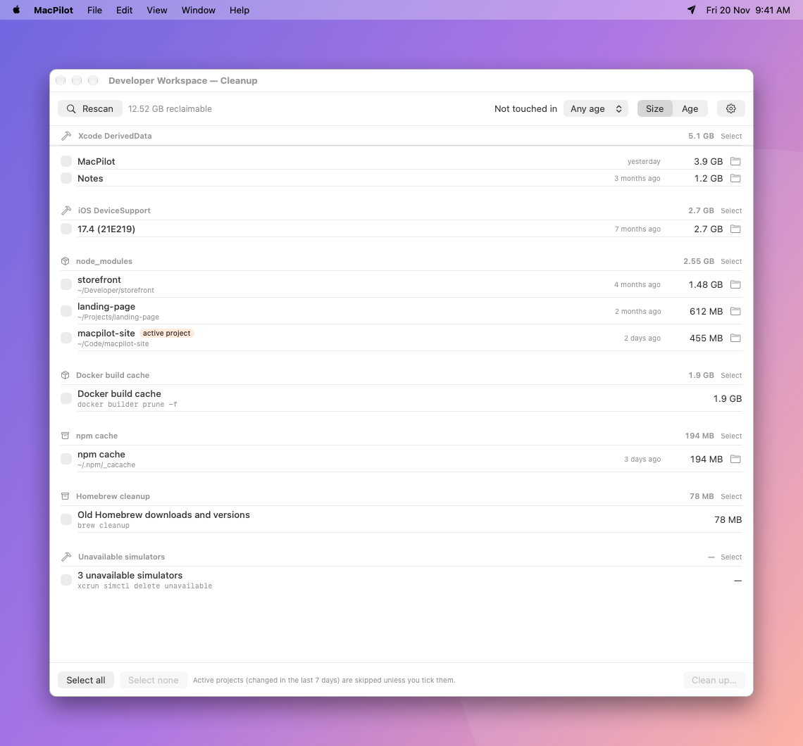

**Developer → Cleanup** scans in the background (low priority, **Cancel** any time) and groups what it finds by category with sizes. Sort by size or age, filter to items **not touched in 30 or 90 days**, tick what you want, **Select all**, and **Reveal in Finder**. The dashboard card shows the total from the last scan.

| Category | What | How it's cleaned |
| --- | --- | --- |
| node_modules | in ~/Developer, ~/Projects, ~/Code, ~/Documents (change the folders with ⚙︎), with project name, size and last change | Trash |
| Xcode | DerivedData, Archives older than 90 days, iOS DeviceSupport, simulator caches | Trash (caches may be deleted permanently) |
| Unavailable simulators | | `xcrun simctl delete unavailable` |
| Docker (if installed) | dangling images, stopped containers, build cache, sized with `docker system df` | `docker image prune -f`, `docker container prune -f`, `docker builder prune -f` |
| Package caches | npm, Yarn, pnpm, pip, CocoaPods, Gradle | Trash (or permanently) |
| Homebrew | old downloads and versions, sized with `brew cleanup -n` | `brew cleanup` |
| Optional | Swift `.build` folders, Python virtualenvs (off by default) | Trash |

**Safety**
- Every cleanup asks first and shows the item count and total size. Files go to the **Trash** by default; **Delete permanently** is offered only when everything selected is a cache, and asks a second time.
- Nothing outside the scanned folders and the known cache folders is touched. Paths are resolved first; symlinks, and paths that lead outside through one, are refused.
- node_modules of projects changed in the last 7 days are marked “active project” and skipped by Select all — tick them yourself if you mean it.
- Commands (simctl, Docker, Homebrew) are shown exactly before they run. Docker only removes dangling images, never images you still use.
- Every cleanup is written to the agent's audit log.

**Elsewhere**
- **⌥K:** “clean up developer files” or “how much can I free?” opens Cleanup and starts a scan.
- **Telegram:** `/cleanup` replies with the totals by category. It can only move **caches** to the Trash, and only after you press **Approve** (yours alone, once, within 10 minutes). node_modules, archives, Docker and Homebrew stay for the Mac.
- **Agent:** `scan_cleanup` (low risk) and `run_cleanup` (high risk: the approval lists the exact paths, size and commands; permanent delete of anything but caches is refused).
- **Monthly reminder** (off by default, in ⚙︎): “Developer files are using 20 GB” when they pass 5 GB.

## Auto-updates

MacPilot uses [Sparkle 2](https://sparkle-project.org) to update itself.

- **Settings → General:** your version and build, **Automatically check for updates** (daily, on by default), **Automatically download and install** (off by default) and **Check for Updates…**. The same button is in the menu bar and ⌥K. Telegram `/version` says whether an update is available; updates are never installed from Telegram.
- **Where updates come from:** the feed is `appcast.xml` on the repository's **main** branch (`https://raw.githubusercontent.com/codecraft26/macPilot/main/appcast.xml`), and each entry points at `releases/MacPilot-<version>.dmg` on main. Updates reach people only after a release is merged into main.
- **Signed updates:** every DMG is signed with an EdDSA (Ed25519) key. The public half is `SUPublicEDKey` in Info.plist; the private half stays in the release Mac's login Keychain and is never in the repository. Sparkle refuses an update whose signature doesn't match — this works for MacPilot's ad-hoc code signature too.
- **Permissions after an update:** until MacPilot is signed with an Apple Developer ID, macOS sees each update as a new app, so it may ask again for Accessibility and Screen Recording. A Developer ID signature (`SIGN_IDENTITY=… NOTARY_PROFILE=… scripts/release.sh`) fixes that and removes the "allow it once" step on install.

**Making a release (maintainers)**
1. Once per Mac: create the update key with Sparkle's `generate_keys` (`scripts/release.sh` downloads Sparkle's tools on first run and tells you the path). It goes into your login Keychain; back it up with `generate_keys -x` somewhere safe — never in the repo.
2. Bump `CFBundleShortVersionString` / `CFBundleVersion` in `Resources/Info.plist` and add a `## <version>` section to `CHANGELOG.md` (shown as release notes).
3. Run `scripts/release.sh`. It puts the matching public key into Info.plist (first time), builds, makes the DMG, signs it with the Keychain key, copies it to `releases/` and adds the release to `appcast.xml` — keeping the newest three and dropping entries whose DMG is gone, so there are no broken links.
4. Commit and merge into main. To host DMGs on GitHub Releases instead, run with `BASE_URL=…` pointing at the release downloads.

## Telegram bot

Control the agent from your phone. MacPilot talks to Telegram's Bot API by **long polling** — it never opens a port on your Mac.

**Set up (once)**
1. In Telegram, open a chat with **@BotFather**, send `/newbot`, choose a name and a username ending in `bot`. BotFather replies with a token like `123456789:AA…`.
2. Optional but recommended: in BotFather send `/setjoingroups` → your bot → **Disable**, so it can't be added to groups.
3. On the Mac: **Settings (⌘,) → Agent tab → Telegram** (scroll down). “Bot: Off” is normal until you finish these steps; the section tells you the next one. Paste the token and press **Save** (it goes to the Keychain only, never to settings files, the database or logs). **Test** checks it with `getMe`. Turn on **Connect the bot**.
4. Press **Pair a phone…**. MacPilot shows an 8-character code valid for 5 minutes. In a **private chat** with your bot, send `/pair CODE`. The code works once (five wrong tries cancel it). Your numeric Telegram user ID and chat ID are saved — usernames are never used for identity. Paired people are listed in Settings with **Remove**.

**Commands**

| Command | What it does |
|---|---|
| *any text* | Starts an agent task (channel “telegram”). The bot replies at once with the task ID and edits that message at milestones (rate-limited); the final message has a summary and a short redacted log. |
| `/new` | Starts a new chat. Otherwise each message continues your current chat (the agent sees what came before); 30 minutes of quiet also starts a new one. |
| `/status` | Active task, queue, network, kill switch and whether the screen is locked |
| `/tasks`, `/cancel <id>` | Recent tasks; stop one |
| `/model` | Provider and model in use (never keys) |
| `/screenshot` | The main display with MacPilot's windows hidden, downscaled to fit Telegram's photo limit. Refused while the screen is locked, explains when Screen Recording permission is missing, and every capture is audit-logged. |
| `/approve <id>`, `/deny <id>` | Answer an approval (same as the buttons) |
| `/start`, `/help` | How to pair; the command list and a privacy note |

**Approvals:** when a task needs approval, the bot sends the exact command, path or diff with **Approve once** and **Deny** buttons. Each button carries the approval ID and a random nonce; it only works for the paired person who started the task, once, within 10 minutes, and only while the action is exactly what was shown. The buttons are removed after a decision or when it expires. You can also answer in the app.

**Limits and privacy:** unpaired senders, group chats and bots are refused and never reach a tool. Messages are rate-limited per user. Everything the bot sends is passed through the same secret redaction as the audit log. The kill switch blocks new tasks and screenshots; local-only mode still blocks cloud providers. The menu bar shows whether the bot is online. Telegram is cloud messaging, not end-to-end encrypted: what you send and what MacPilot replies passes through Telegram's servers.

## Scheduled jobs

**Agent → Jobs** runs the agent on a schedule while MacPilot is open. Each run is an ordinary agent task (marked *schedule*) with the same step, time, token and cost limits, the kill switch and local-only mode.

- **Schedules:** every day at a time, chosen weekdays, every N hours, or cron (`minute hour day month weekday`, e.g. `0 9 * * 1-5`), always in a named time zone so 9:00 stays 9:00 across daylight-saving changes (a time that doesn't exist that day moves to the next valid time; a repeated hour runs once).
- **Missed runs:** if the Mac was asleep or MacPilot was closed, each missed job runs **once** at the next launch and then continues on schedule — never a burst of catch-up runs.
- **Controls:** pause, resume, run now, edit, delete, and a run history with summaries, links to each run's timeline, and job-finder results.
- **What a job may do:** only `web_search`, `fetch_page`, `extract`, `compare_with_last_run` (change detection, e.g. “price changed from $399 to $349”) and `send_email` to its own recipient. Files and commands are not available to scheduled jobs. Text from web pages is passed to the model as untrusted data, so instructions hidden in a page can't trigger anything outside that list.
- **Email:** choose **Mail** (the Mail app's default account, via AppleScript; macOS asks once for Automation permission) or a connected **Gmail** account (MacPilot asks Google for the `gmail.send` permission only when you choose it). When you create a job you see the exact recipient, sender, schedule and a rendered sample email, and approve it once. That approval is bound to the job, the recipient address and the sending account; changing either needs a new approval. Every email is written to the audit log, a job can never email anyone else, and outside jobs `send_email` is high risk: it always asks, and only to an address you typed.
- **Web tools:** `web_search` uses a Brave Search or SerpAPI key if you add one (Settings → Agent → Web search, stored in the Keychain), otherwise DuckDuckGo's HTML results. `fetch_page` turns a page into readable text (optionally just the element matching a CSS selector like `.price` or `#main`). Requests identify as **MacPilot**, honor robots.txt (cached for a day), wait at least 2 seconds between requests to the same site, send no cookies, and skip pages behind a login.
- **Telegram:** `/jobs` lists jobs with **Pause/Resume** and **Run now** buttons; `/newjob every day at 8am check the price of … email me at me@example.com` creates one from plain words (the email still has to be approved, with a button only you can use). Jobs can also post their results to Telegram.

## Job finder

A built-in job template (Agent → Jobs → New job → Job finder) that doesn't need AI to collect postings:

- **Sources:** the public JSON job-board APIs of the companies you list — Greenhouse (`boards-api.greenhouse.io`), Lever (`api.lever.co`) and Ashby (`api.ashbyhq.com` posting API). It starts with 30 well-known tech companies (Airbnb, Stripe, Figma, Cloudflare, Datadog, Anthropic, Spotify, Notion, OpenAI, Linear, …); edit the list as `greenhouse:slug Name` lines — the slug is in the company's careers URL. Add any **RSS/Atom** job feeds, and optionally your own **LinkedIn and Indeed job-alert emails** from Mail or Gmail (`gmail.readonly`, asked only if you choose it). MacPilot never scrapes the LinkedIn or Indeed websites.
- **Filters:** role keywords, location (plus remote, or remote only), experience level (entry, mid, senior, staff/lead), words to exclude, and a maximum posting age.
- **Only new postings:** results are deduplicated within a run and across runs by canonical URL (tracking parameters removed) and by company + title.
- **The email:** company, title, location, posted date and apply link, grouped by company, with HTML and plain-text versions. Nothing new means no email. Results also appear under the job in the app, and in Telegram if you turn that on.

## Network speed and speed test


**Beside the notch** (on by default): download and upload speed on the left, CPU usage on the right. CPU turns orange from 80%; digits are monospaced so the text doesn't jitter. Whenever the notch has something else to show (recording, dictation, a timer, a meeting countdown, music or an alert), the readout steps aside and returns afterwards. Hovering the readout doesn't expand the notch; hovering the notch itself still does.

**Click the readout** (or menu bar → System Monitor…) for a small panel with 60-second graphs for CPU and network, a bar per core, memory in use, the 5 busiest processes and a **Speed Test** button.

| | |
| --- | --- |
| 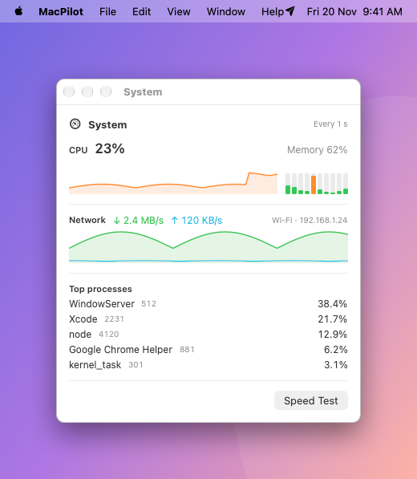 | 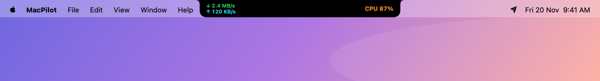 |

- **Macs without a notch** (or with MacPilot's notch turned off): the same readout goes in the menu bar, e.g. `↓2.4M ↑120K  CPU 23%`. Settings → Notch → Menu bar readout: Automatic, Network, CPU, both or Off.
- **Settings → Notch:** separate toggles for network and CPU, units (Auto, MB/s or Mbps) and updates every 1 or 2 seconds.
- **Light on the Mac:** one sample (CPU ticks from `host_processor_info`, memory, interface counters) takes about 70 µs, roughly 0.01% CPU at one per second; a test fails above 1%. The process list is only read while the panel is open. Everything pauses while the screen is locked, the displays sleep or the Mac sleeps.

- **Live throughput:** MacPilot reads the byte counters of your active interfaces once a second (`getifaddrs`; loopback, VPN tunnels and AirDrop links are skipped so nothing is counted twice) and shows download ↓ and upload ↑ rates.
- **Where it shows:** the expanded notch has a network card with a 1-minute graph and a speed test button; turn on **Network speed: show ↓/↑ next to the notch** for a compact readout whenever nothing else is showing. The dashboard's **Network** card has a live graph, interface name and local IP (⌥K → “Network” copies the IP). **Network speed in the menu bar** adds a small readout next to the MacPilot icon (off by default). All in **Settings → Recording & Calendar → Notch**.
- **Speed test:** uses `networkQuality -c` (built into macOS 12+) for download and upload in Mbps and idle latency in ms, with a progress bar (a test takes about 20 seconds). The last 20 results are kept on this Mac (dashboard → Network → History). Start it from the dashboard, the notch, ⌥K → **Speed test**, or tell Pilot *“run a speed test”* — it reads the result out loud.

## Finder: Convert with MacPilot

Select one or more files in Finder, right-click and choose **Quick Actions → Convert with MacPilot** (on some macOS versions **Services → Convert with MacPilot**). A small window lists only the File Tools conversions that fit the selection — e.g. PDF → Word, compress or OCR for a PDF; merge for two or more PDFs; convert, resize or images → PDF for photos; MP4 or extract audio for videos — with the same options as File Tools. Results are saved next to the originals (never overwriting). Files parked on the notch shelf have the same **Convert…** button and right-click item.

If the item doesn't appear: open **System Settings → Keyboard → Keyboard Shortcuts… → Services**, find **Convert with MacPilot** under *Files and Folders* and tick it. MacPilot needs to be in /Applications and opened once; if it's still missing, log out and back in (or run `/System/Library/CoreServices/pbs -update`).

## Recording and meetings

**Automatic recording:** in **Calendar → Auto-record**, choose **Off** (only meetings you mark), **All meetings**, **Meetings with a video link** (Zoom, Meet, Teams, Webex…) or **Meetings in selected calendars**, and optionally only events with attendees or a video link. Right-click any meeting → **Record automatically when it starts** to switch a single meeting on or off whatever the rule says. Recording starts a minute before the meeting and (optionally) stops when it ends. When it starts, the notch drops an alert with a **Stop** button; **Remind me to tell attendees they're recorded** (on by default) adds that reminder to the alert and notification. Upcoming meetings that will be recorded show a red dot; past ones that were recorded show a waveform badge with **Recording · Transcript · Summary** links (also in the right-click menu), and the **Recorded** toggle in the calendar toolbar shows only recorded events.

**One-click follow-up:** on a meeting with a summary, **Do the follow-up** opens the follow-up email as a Mail draft addressed to the attendees (you review and send), adds the action items as tasks (skipping ones already added; they sync to Reminders), and **Schedule next meeting…** opens a pre-filled event to confirm.

- **Voice & Transcription** records voice notes (microphone) and imports audio files (MP3, WAV, M4A, FLAC, OGG, AAC). Pick the microphone in **Settings → Recording & Calendar**; pause, resume and a level meter are in the recording bar and the menu bar.
- **Meetings** (⌥R, or **Record** on a calendar event) record the microphone as “Me” and, with Screen & System Audio Recording permission, system audio as “Others” in a separate track via ScreenCaptureKit. Without that permission MacPilot keeps recording the microphone and says so.
- After you stop, MacPilot uses the audio transcription and transcript analysis providers selected in **Settings → Routing**. Analysis produces a summary, decisions, action items with owners and due dates, deadlines, open questions, and a follow-up email draft. Turn off **Transcribe and summarize automatically** in **Settings → Recording & Calendar** to start each step yourself.
- The transcript editor plays both tracks together; click a timestamp to seek, edit any line, rename speakers, search, and export Markdown, TXT or SRT. Action items become tasks (category “Meeting”); **Save as note** and **Ask AI** reuse the transcript.
- Audio lives in `~/Library/Application Support/MacPilot/Recordings/`. Set a retention period in **Settings → Privacy & Data**.

### Transcription providers

- **OpenAI** is the default. Save your OpenAI API key in **Settings → Providers** and set **File transcription model** under **Settings → Routing → Audio transcription**. The default is `gpt-4o-transcribe`. MacPilot splits long audio it can decode into two-minute uploads. Choose `whisper-1` for segment timestamps returned by OpenAI.
- **Amazon Transcribe (AWS)** streams saved tracks in real time when the S3 bucket field is blank. Enter a bucket in the transcription region to use batch jobs with speaker labels.
- **Amazon Bedrock Data Automation** reads saved audio from S3 and returns timestamped transcript segments. Enter your S3 bucket and Data Automation profile ARN. You can also enter a project ARN to use its audio standard output settings. Enable full transcription in the project and speaker labeling if you want individual speaker labels. [Bedrock audio output](https://docs.aws.amazon.com/bedrock/latest/userguide/audio-processing.html)
- **Local Whisper (on device)** runs `whisper-cli` on this Mac. Install [whisper.cpp](https://github.com/ggml-org/whisper.cpp#quick-start) and download a [GGML model](https://github.com/ggml-org/whisper.cpp/tree/master/models), then select the model in **Settings → Routing → Local Whisper**. MacPilot finds the executable in the default Homebrew locations. Use **Choose…** if you installed it somewhere else. Transcript analysis still uses the provider selected separately in Routing.

#### AWS setup

1. Save an AWS **Access key** in **Settings → Providers → Claude (Bedrock)**. Include the session token for temporary credentials. A Bedrock bearer key works for Claude chat and analysis. AWS transcription uses the AWS access key and secret.
2. In **Settings → Routing → Audio transcription**, select **Amazon Transcribe (AWS)** or **Amazon Bedrock Data Automation**. The transcription region defaults to the Bedrock region. Set an override if your transcription services use another region.
3. For Amazon Transcribe streaming and live captions, give the AWS identity `transcribe:StartStreamTranscriptionWebSocket`. For batch, it needs `transcribe:StartTranscriptionJob`, `transcribe:GetTranscriptionJob`, and read and write access to your input bucket. If you enable cleanup, also allow `s3:DeleteObject` and `transcribe:DeleteTranscriptionJob`. To remove S3 files when you delete a recording (and for **Clean up S3** in Settings → Routing), also allow `s3:ListBucket` on the bucket for the `macpilot/` prefix. If the bucket doesn't exist, MacPilot creates it (private, S3-managed encryption, with a rule that expires `macpilot/` files after a day) when it first needs it or when you press **Create bucket**; that needs `s3:CreateBucket` and, for the rule, `s3:PutLifecycleConfiguration`. [Amazon Transcribe streaming setup](https://docs.aws.amazon.com/transcribe/latest/dg/streaming-setting-up.html) · [Batch requests](https://docs.aws.amazon.com/transcribe/latest/APIReference/API_StartTranscriptionJob.html)
4. For Bedrock Data Automation, configure `bedrock:InvokeDataAutomationAsync` and `bedrock:GetDataAutomationStatus` for the profile and invocation resources, and allow the required reads and writes on the bucket. For example, a supported US profile uses an ARN ending in `data-automation-profile/us.data-automation-v1`. MacPilot can delete the uploaded audio after a completed job if granted `s3:DeleteObject`. Bedrock output stays in S3 and is subject to your bucket's retention policy. [Bedrock profiles and permissions](https://docs.aws.amazon.com/bedrock/latest/userguide/bda-cris.html) · [S3 access](https://docs.aws.amazon.com/bedrock/latest/userguide/s3-bucket-access.html)

Enable **Live microphone captions via Amazon Transcribe** under either AWS provider. Captions appear in Voice and Calendar & Meetings while you record. System audio is transcribed afterward. With Amazon Transcribe, you can reuse a completed live microphone transcript for an uninterrupted recording. Paused or failed streams use the saved microphone audio for the final transcript.

## Automations

Open **Automations → New Workflow**. Choose **Recording finished**, **Meeting ended**, **Transcript ready**, or **Daily summary**. For recording and meeting triggers, you can filter by title and minimum duration. **Meeting ended** follows the scheduled end time of visible events in connected calendars. A daily summary collects the day's calendar events and open tasks due by the end of that day. Scheduled workflows run while MacPilot is open and use the Mac's local time.

Workflows can create a note or task and can optionally require approval first. **Copy transcript** always asks for approval. Review the proposed content under **Needs Approval**, and check completed, declined, and failed actions in **Run History**. A workflow runs once for a matching recording, meeting occurrence, or daily schedule.

## Calendar

- **Calendar & Meetings** reads Apple Calendar through EventKit (full access, asked once): day, week and month views, calendar filters, conflict highlighting, and tasks due each day.
- Create, edit and delete events with an alert. **Quick add** (“Lunch with Sam Friday 1pm”) is read by the analysis provider (or by macOS date detection if no provider is available) and always opens the editor so you confirm before anything is saved.
- **Google Calendar (optional):** in **Settings → Recording & Calendar**, paste the client ID and secret of a Google Cloud OAuth client of type *Desktop app* (Google Calendar API enabled), press **Connect** and approve in your browser. Google calendars then appear next to Apple ones (marked with a G), with the same views, conflict checks, quick add, Record and Prep notes. Sign-in uses PKCE with a loopback redirect; the refresh token and client secret stay in the Keychain. Alternatively add the Google account under System Settings → Internet Accounts and it shows up through Apple Calendar.
- Each event has **Record** (a meeting linked to the event, with its attendees) and **Prep notes** (a note linked to the event; its text is included when the meeting is analyzed). The dashboard shows upcoming meetings with a live countdown.

## Google Calendar: several accounts

In **Settings → Recording & Calendar → Google Calendar**, enter your OAuth client ID once and press **Connect Google Calendar**. To add more accounts, press **Add another Google account** — Google's account chooser opens in your browser, so you can pick a different account (or add one). For each account MacPilot lists every calendar it can see — your own, shared and subscribed (holidays, team calendars) — with color, a read-only marker and a show/hide toggle, plus **Show all / Hide all** and **Disconnect…** per account.

- The calendar view's **Calendars** menu groups Google calendars by account; the event editor shows which account each calendar belongs to, and events can be moved between calendars and accounts.
- A calendar shared with two of your accounts is listed once, from the account that can edit it, so events don't appear twice.
- Each account's refresh token is stored separately in the Keychain. Disconnecting one revokes only its access. A connection made with an earlier version is kept and becomes your first account.

## Notch

On MacBooks with a notch, MacPilot lives around the camera like a Dynamic Island: a red **REC** dot and timer while recording, a waveform while dictating, and a countdown when a meeting starts within 15 minutes. Point at the notch to expand it: recording controls with live captions, the next meeting with **Join** (Zoom, Meet, Teams, Webex links found in the event) and **Record**, and quick actions — Ask AI, Dictate, Record, Clipboard, Launcher, Note. On other screens it appears at the top centre only while something is happening. It also shows **music** from Music or Spotify (artwork, title, equalizer, play/pause/next — macOS asks once to let MacPilot control the player), **timers** (type `timer 25m` or `timer 1h30m deep work` in ⌥K: a countdown ring in the notch, +5 min, a chime and a notification when done), and short **peeks** that drop out of the notch: a meeting starting now (click to join), a task falling due, a summary that's ready (click to open) and a finished timer. It can also show **network speed** (↓/↑ next to the notch and a 1-minute graph when expanded, see [Network](#network-speed-and-speed-test)) and **Convert…** for files on the shelf. Turn it off or change it in **Settings → Recording & Calendar → Notch**.

| Recording | Meeting soon | Expanded |
|---|---|---|
| 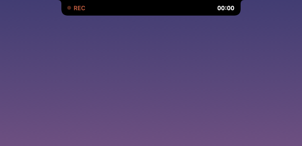 |  |  |

## Dictation (⌥D)

- **Hold ⌥D** anywhere, speak, and release: MacPilot transcribes, cleans up the text and pastes it where your cursor is. A **quick tap** starts hands-free mode; tap again to finish. **Esc** or the ✕ on the pill cancels.
- A small pill at the bottom of the screen shows the mic level, timer and, with Amazon Transcribe, the words as you speak. It never takes focus from your app.
- Speech to text uses the provider in **Settings → Routing** (OpenAI, Amazon Transcribe, Bedrock or local Whisper). Cleanup (punctuation, fillers, grammar) uses the analysis provider; without AI, fillers are removed locally.
- Styles: Plain, Message, Email, Code prompt and Translate — pick the default in **Settings → Dictation** or change it on the pill. **⌥⇧T** turns speech into a task, with any spoken date as the due date.
- Your clipboard is restored after pasting, and MacPilot's own pastes are not added to clipboard history. Pasting needs **Accessibility** permission; without it the text is copied and you press ⌘V.
- Add names and technical terms under **Settings → Dictation → Vocabulary** so they're spelled right. The last 50 dictations are in **Voice & Transcription → Dictations**.

## Apple Reminders

Turn on **Settings → Recording & Calendar → Reminders → Sync tasks with Apple Reminders**. MacPilot keeps its tasks and one Reminders list (“MacPilot” by default, created if needed) in step both ways: title, notes, due date and time, priority and done state. Reminders you add in that list on your Mac or iPhone appear as tasks; deleting on either side deletes on the other (unless the other side changed since the last sync). If both sides changed, this Mac's edit wins and a completion on either side counts. It syncs on every change, when Reminders changes, and every 5 minutes; **Reminders** in the Tasks header syncs on demand.

## AI on selected text (⌥⇧E)

Select text in any app and press **⌥⇧E**. Pick an action — fix spelling & grammar, rewrite more clearly, make shorter or longer, more professional or friendly, bullet points, summarize, explain, draft a reply, translate — or type your own instruction. **⌘1–9** runs an action, **Return** replaces the selection in the original app (the clipboard is restored afterwards), **⌘Return** copies. Needs Accessibility; apps that don't expose the selection (browsers, Electron) are read with a quick ⌘C. Uses the analysis provider from Settings (e.g. Claude on Bedrock).

**Your own AI commands:** save prompts like “Tweet from selection”, “Commit message” or “Find bugs” in **Settings → Snippets & Links → AI commands**. They appear in ⌥⇧E under “Your commands” and as ⌥K commands that run on the current selection.

## Floating buddy

**Talking to Pilot:** click it and speak (it chimes, listens until you pause, then answers). Speech recognition runs on this Mac when your Mac supports it; questions that aren't commands go to the AI provider you chose for analysis. Turn spoken replies off in **Settings → Shortcuts → Floating buddy → Answer out loud** (the answer still shows in the bubble). **“Hey Pilot”** is off by default: when you turn it on, MacPilot keeps listening with **on-device recognition only** (it won't run on Macs that can't do that), and pauses while you record or dictate. macOS asks once for Microphone and Speech Recognition permission. Click the bubble to stop it talking.

A small always-on-top character (bottom-right by default). Click: Ask AI (⌥Space). Buttons: record/stop a voice note, dictate (tap to start hands-free, tap again to paste), new note, and ⋯ for Ask my Mac, screenshot, clipboard and launcher. Right-click for record meeting, new task, dashboard and Hide. Drag to move; the position is remembered.

**Hide or show it:** hover and click the **×** at its top-right corner to hide it (it stays hidden after restarts). Bring it back from the menu bar (the item reads “Show Floating Buddy” while it's hidden and “Hide Floating Buddy” while it's visible), ⌥K → “Show / hide floating buddy”, or **Settings → Shortcuts → Floating buddy**. The idle animation runs at a low frame rate to save battery, and the buddy is hidden from screen sharing and screenshots like every MacPilot window.

## Morning briefing

The dashboard opens with **Today's briefing**: an AI summary of today's meetings, tasks due today and overdue, and open action items from the last three days of meetings, ending with a suggested focus. Written once each morning (turn that off from the card's ⋯ menu) or on demand with Refresh; without an AI provider it shows the plain list.

## Screenshots and screen-aware assistant

- **⌥⇧S** works like ⌘⇧4 (drag an area; Space picks a window). MacPilot reads the text, then you can copy the text or image, ask AI about it, **pin it** as a floating always-on-top image (drag to move, double-click or Esc to close), or save it to the Desktop.
- In the **⌥Space** assistant, the 👁 button reads the window you were using, so you can ask “summarize this”, “reply to this email” or “what does this error mean”. ⌥K → “Ask AI about this window” does it in one step.
- Needs Screen Recording permission (the same one meeting recording uses). Text is read on the Mac; only the text goes to your AI provider.

## Ask my Mac (⌥⇧A)

Ask questions like “What did we decide about the launch date?” or “Which tasks are due this week?”. MacPilot ranks your notes, tasks, meeting summaries/transcripts and recent clipboard text **on this Mac**, sends only the best-matching passages with your question to the AI, and shows the answer with numbered sources — click one (or ⌘1–9) to open that note, meeting or task.


## Hidden from screen sharing

By default MacPilot's windows (main window, ⌥K/⌥C/⌥⇧E/⌥⇧A panels, assistant, notch) are marked non-shareable, so screenshots, screen recordings and Zoom/Meet/Teams shares show what's behind them while you still see them. Turn it off in **Settings → Privacy & Data**. macOS decides whether each capture app honors this; if one still shows MacPilot, share a single window instead of the whole screen. MacPilot's own screen recordings leave MacPilot out separately (Settings → Recording).

## iCloud sync between your Macs

Turn on **Settings → Sync** on each Mac (same Apple Account, iCloud Drive on). Notes, tasks, meeting transcripts and summaries, AI chats, the prompt library, and snippets & quick links sync through `iCloud Drive/MacPilot/Sync/`, usually within a minute.

- Each Mac writes only its own file and reads the others, so iCloud never has to merge one file edited on two Macs. The newest edit of an item wins; deletions sync too.
- Tasks linked to Apple Reminders are matched to the same reminder on every Mac (by Apple's cross-device id), so nothing is duplicated.
- Not synced: clipboard history, audio/screen video files (meetings arrive with transcript and summary), API keys and AWS credentials (Keychain, per Mac), app settings.
- Why iCloud Drive and not CloudKit: CloudKit needs the app signed by a paid Apple Developer team; this works with the ad-hoc signed build. macOS may ask once to let MacPilot access iCloud Drive.

## File Tools

A **File Tools** section (also searchable from ⌥K) with on-device converters — nothing is uploaded:

- **PDF:** PDF → Word (.docx; scanned pages are read with OCR), merge, split (every page or ranges like `1-3, 5, 8-`), compress, password-protect, PDF → PNG/JPEG pages.
- **Documents:** Word/DOC/RTF/ODT/HTML/TXT → PDF, convert between DOCX, RTF, HTML, ODT and plain text, Markdown → Word or PDF.
- **Images:** images → one PDF, convert between HEIC, JPEG, PNG and TIFF (quality slider), resize to fit, extract text (OCR) from images and scanned PDFs.
- **Audio & video:** video → MP4 (720p, 1080p or original), extract the soundtrack as M4A.

**Edit PDF pages** shows every page as a thumbnail: rotate left/right, drag to reorder, delete, duplicate, reverse, select odd/even pages, extract the selection to a new PDF, add page numbers (position, format, start number) and a text watermark, with undo. Page text stays selectable.

Drop files on a tool (or choose them), set options, press Convert; results are saved next to the originals (never overwriting) with Open and Show in Finder. PDF → Word keeps the text and basic formatting; complex layouts, tables and images are simplified. You can also start a conversion from Finder (right-click → **Convert with MacPilot**, see [Finder convert](#finder-convert-with-macpilot)) or from files parked on the notch.


## Clipboard history (Raycast-style)

- MacPilot saves what you copy: text, rich text, links, files, colors and (optionally) images, with the app it came from. Copying the same thing again moves it to the top instead of duplicating it.
- **⌥C** opens a floating panel over the app you are in: type to fuzzy-search, ↑/↓ to move, **Return** pastes into that app, **⇧Return** pastes as plain text, **⌘Return** only copies, **⌘1–⌘9** quick-paste, **⌘P** pin, **⌘F** favorite, **⌘⌫** delete, **Tab** cycles filters (Text, Links, Images, Code, Files, Favorites, Pinned), **Esc** closes.
- Pasting into other apps needs **Accessibility** permission (System Settings → Privacy & Security → Accessibility; on macOS 27 “Device Control and Data Access”). Without it, Return copies and you press ⌘V.
- Never saved: items marked concealed/transient by password managers, copies from excluded apps (1Password, Bitwarden, Keychain Access, Passwords, LastPass, Dashlane by default) and anything that looks like an API key, token, private key or card number. Pause capture from the menu bar.
- The **Clipboard** section has the full history with folders, pins, favorites, retention (1 day–unlimited, max items) and AI actions: Explain, Summarize, Fix grammar, Translate, Format JSON.

## Command launcher

**⌥K** opens a Raycast-style launcher. Type to search, ↑/↓ to move, Return runs, ⌘Return runs the second action, Esc closes.

- **Commands:** new note, task or event, start/stop recording, voice note, clipboard history, open any section.
- **Calculator and conversions:** `12*(3+4)`, `2^10`, `10 km to mi`, `72 f in c`, `5 kg -> lb`. Return copies the result, ⌘Return pastes it into your app.
- **Apps:** open installed apps; running ones show “Running” and ⌘Return quits them.
- **Files:** Spotlight search of your home folder; ⌘Return shows the file in Finder.
- **Notes, tasks and clipboard:** jump to a note, complete a task, paste a clip.
- **Window management** (needs Accessibility): Window: Left/Right/Top/Bottom half, Left/Center/Right third, two thirds, Maximize, Center — applied to the window you were using.
- **System:** Lock Screen, Sleep Display, Start Screen Saver, Toggle Dark Mode (macOS asks once to allow controlling System Events), Empty Trash (always asks first).
- **Web:** typing a domain or URL opens it; “Search Google / YouTube / GitHub for …” is always at the bottom; “Ask AI” sends the text to the quick assistant.
- **Quick links:** `g swift actors`, `yt lofi`, `gh macpilot`, `maps coffee`, `wiki …`, `tr …`, `so …`, `jira ABC-123` open the matching URL. Edit them (and add your own with `{query}`) in **Settings → Snippets & Links**.
- **Snippets:** type a keyword such as `;date`, `;time`, `;sig` or `;standup` in any app and it expands into the saved text (`{date}`, `{time}`, `{datetime}`, `{clipboard}` are filled in). Also searchable in ⌥K. Needs Accessibility; can be turned off in Settings.
- The launcher learns what you use: frequent and recent items move up (stored only on this Mac).

## Developer workspace

- **Repositories:** add folders; see branch, ahead/behind, changes (`git status --porcelain=v2`), recent commits, switch branch, stage all and commit with an AI-written message. Open in VS Code, Terminal or Finder.
- **AI tools:** explain an error, review code, generate tests, explain code (paste or use the staged diff), and write a PR summary from the branch's commits.
- **Terminal:** saved commands per repository and one-off commands. Every run shows the exact command and folder for confirmation; commands that delete, overwrite, force-push, use sudo and similar need a second “I understand”. Output streams live with a Stop button; history is kept with secrets removed.
- **API:** request builder with method, URL, headers and body, response status, time, headers and pretty JSON; saved requests never store Authorization, Cookie or API-key header values.
- **JSON:** format, minify, validate, sort keys.

## Architecture

```
Sources/MacPilot
├── App/          App entry, AppState, window/panel management, global hotkeys (Carbon)
├── AI/           Provider protocol, Anthropic / OpenAI / Ollama streaming clients, router, usage limits
├── Models/       SwiftData models (Conversation, ChatMessage, PromptTemplate, Note, TaskItem, Recording) and the store
├── Services/     Keychain, preferences, export/delete, notifications, transcription, meeting intelligence, EventKit
│   ├── Audio/    Microphone (AVCaptureSession) and system audio (ScreenCaptureKit) recorders, RecordingManager
│   ├── AWS/      Amazon Transcribe, Bedrock Data Automation, S3 and AWS event-stream framing
│   ├── Clipboard/ Pasteboard monitor, sensitive-content filter, paste service, fuzzy matcher, clip AI actions
│   └── Developer/ git (porcelain v2), argument-array process runner, command safety, HTTP request runner
└── Views/        Dashboard, Assistant, Quick assistant, Voice, Calendar & Meetings, Notes, Tasks, Settings, menu bar
```

- **Provider routing** lets you choose chat, transcript analysis, and audio transcription providers independently in **Settings → Routing**.
- **Claude** uses the Messages API with streaming over raw HTTP (there is no official Swift SDK). The default model is `claude-opus-5-5`. For models that support it, requests opt into the server-side refusal fallback (`anthropic-beta: server-side-fallback-2026-07-01`, `fallbacks: "default"`), so a safety refusal is retried on a suitable model instead of failing.
- **OpenAI** uses Chat Completions streaming. The default model is `gpt-5`; change it or pick from the live list after **Test connection**.
- **Secrets**: keys are read from the Keychain at request time, never stored in SwiftData or UserDefaults, and provider error messages are passed through a redactor before they are shown.
- **Usage limits**: token usage per provider per month is tracked from provider responses; set a monthly token cap in **Settings → Usage**.
- **No backend**: data lives in `~/Library/Application Support/MacPilot/`. Export everything as JSON or delete it from **Settings → Privacy & Data**.

## Contributing

Issues and pull requests are welcome.

1. Fork and create a branch.
2. `swift build` and `swift test` must pass (the suite covers providers, sync, converters, parsing and more).
3. For UI changes, render screenshots with `SNAPSHOT_DIR=/tmp/shots swift test --filter UISnapshots` and include them in the PR.
4. Keep the app private by default: no telemetry, credentials only in the Keychain, and never send content anywhere the user hasn't chosen.
