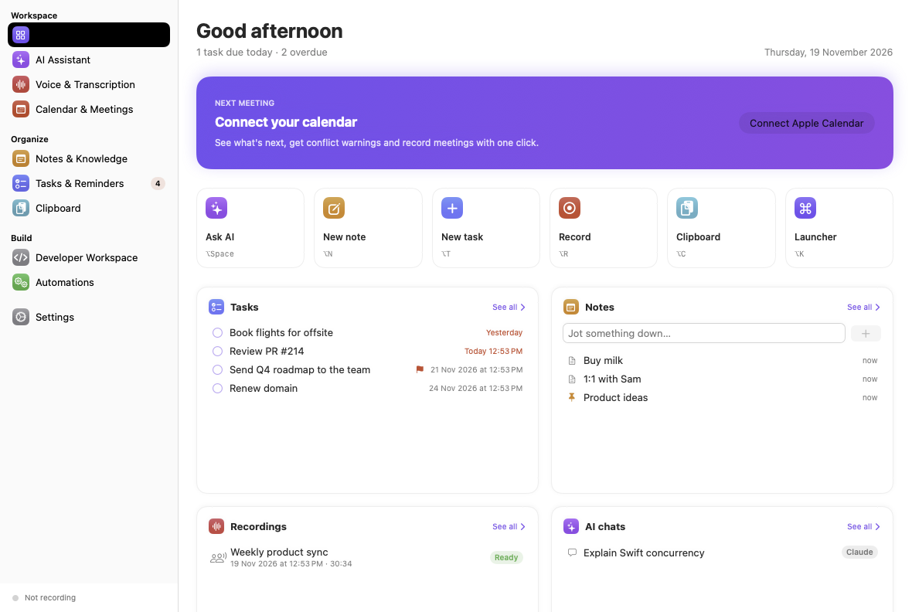
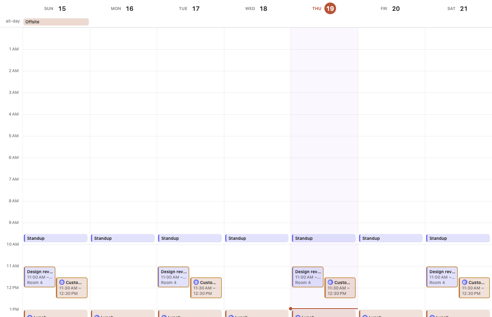
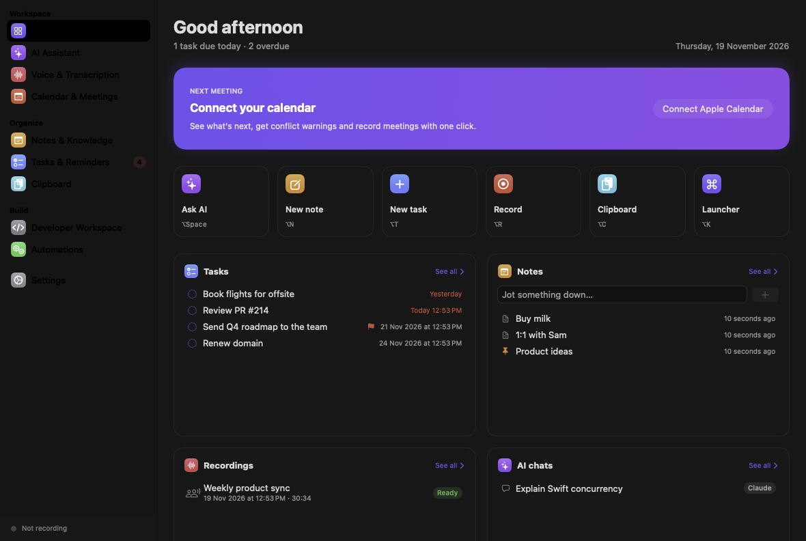
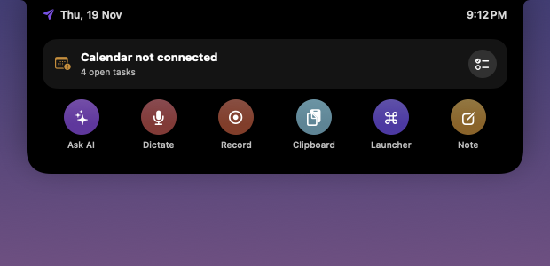
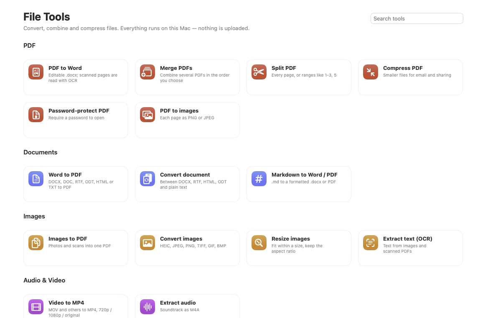

# MacPilot

MacPilot is a native macOS menu bar app with a floating AI assistant, meeting recording, a calendar, notes, tasks, clipboard history, and developer tools. Use your own credentials for Claude through Anthropic or Amazon Bedrock and for OpenAI, or run models locally with Ollama. MacPilot stores app data on your Mac and credentials in the macOS Keychain. Cloud features send the relevant content to the configured service.

## Status

| Phase | Scope | Status |
|---|---|---|
| 1 | Native app, menu bar, dashboard, shortcuts, settings, Keychain | Done |
| 2 | OpenAI + Claude streaming chat, history, prompt library | Done (plus Ollama) |
| 3 | Microphone recording, dictation, transcription, transcript editor | Done: recording, import, transcription, editing and ⌥D push-to-talk dictation. |
| 4 | Meeting recording, system audio, speakers, meeting intelligence | Post-recording analysis and optional live microphone captions with Amazon Transcribe. |
| 5 | Calendar, notes, tasks, reminders | Done (with two-way Apple Reminders sync) |
| 6 | Clipboard manager, developer workspace | Done (plus ⌥K command launcher) |
| 7 | Automations, local Whisper, distribution | Workflows with approvals and run history, on-device transcription with whisper.cpp, and ZIP and DMG packaging. |

## Screenshots

| Dashboard | Assistant |
|---|---|
|  |  |
| **Calendar (week)** | **⌥C clipboard panel** |
|  |  |
| **Recordings** | **Dark mode** |
|  |  |

Rendered offscreen with sample data (`SNAPSHOT_DIR=docs/screenshots/new swift test --filter UISnapshots`), so window chrome and blur are not shown. Earlier versions are in `docs/screenshots/before/`.

## Requirements

- macOS 14 Sonoma or later (Apple silicon or Intel)
- Xcode 15.3+ or the matching Command Line Tools (Swift 5.10+)

## Build and run

```bash
./scripts/build-app.sh          # release build -> build/MacPilot.app
open build/MacPilot.app
```

You can also open `Package.swift` in Xcode and run the `MacPilot` scheme for debugging. Running the bare binary (`swift run`) works too, but task notifications are disabled outside a bundled `.app`.

Run the test suite with `swift test`.

On first launch the dashboard opens on **Settings → Providers**. Save an Anthropic or OpenAI key to test the connection and load available models. For Ollama, enable the provider and enter your server URL (default `http://localhost:11434`). Choose your default chat, transcript analysis, and audio transcription providers in **Settings → Routing**.

### Installing on another Mac

1. Run `./scripts/package.sh` to create `build/MacPilot-<version>.zip` and `build/MacPilot-<version>.dmg`. The script attempts a universal build for Apple silicon and Intel and prints the architectures it packaged. If the universal build fails, it retries for the build Mac's architecture. Share the ZIP or DMG to preserve the app bundle's permissions and structure.
2. On the other Mac, unzip (or open the dmg) and drag **MacPilot** into **Applications**.
3. The default build is not signed with an Apple Developer ID, so macOS blocks the first launch. Allow it once, either:
   - double-click MacPilot, then **System Settings → Privacy & Security**, scroll down and press **Open Anyway**; or
   - in Terminal: `xattr -dr com.apple.quarantine /Applications/MacPilot.app`
4. Open MacPilot. It lives in the menu bar (paper-plane icon); there is no Dock icon until you open the dashboard.

Set `BUILD_DIR=build/release` before running the packaging script to keep a separate set of output files.

For installs that open with no warning, sign with a Developer ID certificate (paid Apple Developer Program) and notarize:

```bash
xcrun notarytool store-credentials macpilot --apple-id you@example.com --team-id TEAMID
SIGN_IDENTITY="Developer ID Application: Your Name (TEAMID)" NOTARY_PROFILE=macpilot scripts/package.sh
```

### Claude via Amazon Bedrock

Use Claude through your own AWS account instead of an Anthropic API key:

1. In the AWS console, enable the Claude models you want under [Amazon Bedrock → Model access](https://console.aws.amazon.com/bedrock/home#/modelaccess) (Opus 5.5, Sonnet 5.5 and Haiku 5.5 may need access requested).
2. Create credentials with IAM permission `bedrock-mantle:CreateInference` on those models: either an **access key** (access key ID + secret, plus a session token for temporary credentials) or an **Amazon Bedrock API key** (that identity also needs `bedrock-mantle:CallWithBearerToken`).
3. In **Settings → Providers → Claude via Amazon Bedrock**, choose *Access key* or *Bedrock API key*, paste the values, pick a region (default `us-east-1`) and press **Save**. Turn the provider on and press **Test connection**.
4. Pick *Bedrock* as the provider for new chats or for transcript analysis in **Settings → Routing**, or per chat.

MacPilot calls `https://bedrock-mantle.<region>.api.aws/anthropic/v1/messages` (the Messages API, streamed) and signs each request with AWS Signature V4 (service `bedrock-mantle`) or sends the API key as a bearer token. Model IDs carry an `anthropic.` prefix (`anthropic.claude-opus-5-5` by default). Credentials are stored only in the Keychain. Bedrock has no models list or server-side refusal fallback, so **Test connection** sends a 16-token “ping” to the selected model.

### Keychain prompts

The build script signs ad hoc by default, so macOS may ask for Keychain access again after each rebuild. To avoid that, sign with your own identity:

```bash
SIGN_IDENTITY="Apple Development: Your Name (TEAMID)" ./scripts/build-app.sh
```

## Default shortcuts

| Shortcut | Action |
|---|---|
| ⌥Space | Floating AI assistant |
| ⌥D | Dictation: hold to talk, release to paste at the cursor (tap once for hands-free) |
| ⌥⇧T | Voice to task: say a task (with a date) and it is added to Tasks |
| ⌥R | Start / stop a meeting recording (named after the current calendar event) |
| ⌥C | Clipboard history panel (search, paste into the current app) |
| ⌥N | New note |
| ⌥T | New task |
| ⌥K | Command launcher: commands, notes, tasks, clipboard, apps, “Ask AI” |

All shortcuts can be changed in **Settings → Shortcuts**. Some macOS versions refuse global shortcuts that use only ⌥ (or ⌥⇧); if that happens, Settings shows the error and you can add ⌃ or ⌘.

## Recording and meetings

- **Voice & Transcription** records voice notes (microphone) and imports audio files (MP3, WAV, M4A, FLAC, OGG, AAC). Pick the microphone in **Settings → Recording & Calendar**; pause, resume and a level meter are in the recording bar and the menu bar.
- **Meetings** (⌥R, or **Record** on a calendar event) record the microphone as “Me” and, with Screen & System Audio Recording permission, system audio as “Others” in a separate track via ScreenCaptureKit. Without that permission MacPilot keeps recording the microphone and says so.
- After you stop, MacPilot uses the audio transcription and transcript analysis providers selected in **Settings → Routing**. Analysis produces a summary, decisions, action items with owners and due dates, deadlines, open questions, and a follow-up email draft. Turn off **Transcribe and summarize automatically** in **Settings → Recording & Calendar** to start each step yourself.
- The transcript editor plays both tracks together; click a timestamp to seek, edit any line, rename speakers, search, and export Markdown, TXT or SRT. Action items become tasks (category “Meeting”); **Save as note** and **Ask AI** reuse the transcript.
- Audio lives in `~/Library/Application Support/MacPilot/Recordings/`. Set a retention period in **Settings → Privacy & Data**.

### Transcription providers

- **OpenAI** is the default. Save your OpenAI API key in **Settings → Providers** and set **File transcription model** under **Settings → Routing → Audio transcription**. The default is `gpt-4o-transcribe`. MacPilot splits long audio it can decode into two-minute uploads. Choose `whisper-1` for segment timestamps returned by OpenAI.
- **Amazon Transcribe (AWS)** streams saved tracks in real time when the S3 bucket field is blank. Enter a bucket in the transcription region to use batch jobs with speaker labels.
- **Amazon Bedrock Data Automation** reads saved audio from S3 and returns timestamped transcript segments. Enter your S3 bucket and Data Automation profile ARN. You can also enter a project ARN to use its audio standard output settings. Enable full transcription in the project and speaker labeling if you want individual speaker labels. [Bedrock audio output](https://docs.aws.amazon.com/bedrock/latest/userguide/audio-processing.html)
- **Local Whisper (on device)** runs `whisper-cli` on this Mac. Install [whisper.cpp](https://github.com/ggml-org/whisper.cpp#quick-start) and download a [GGML model](https://github.com/ggml-org/whisper.cpp/tree/master/models), then select the model in **Settings → Routing → Local Whisper**. MacPilot finds the executable in the default Homebrew locations. Use **Choose…** if you installed it somewhere else. Transcript analysis still uses the provider selected separately in Routing.

#### AWS setup

1. Save an AWS **Access key** in **Settings → Providers → Claude via Amazon Bedrock**. Include the session token for temporary credentials. A Bedrock bearer key works for Claude chat and analysis. AWS transcription uses the AWS access key and secret.
2. In **Settings → Routing → Audio transcription**, select **Amazon Transcribe (AWS)** or **Amazon Bedrock Data Automation**. The transcription region defaults to the Bedrock region. Set an override if your transcription services use another region.
3. For Amazon Transcribe streaming and live captions, give the AWS identity `transcribe:StartStreamTranscriptionWebSocket`. For batch, it needs `transcribe:StartTranscriptionJob`, `transcribe:GetTranscriptionJob`, and read and write access to your input bucket. If you enable cleanup, also allow `s3:DeleteObject` and `transcribe:DeleteTranscriptionJob`. To remove S3 files when you delete a recording (and for **Clean up S3** in Settings → Routing), also allow `s3:ListBucket` on the bucket for the `macpilot/` prefix. If the bucket doesn't exist, MacPilot creates it (private, S3-managed encryption, with a rule that expires `macpilot/` files after a day) when it first needs it or when you press **Create bucket**; that needs `s3:CreateBucket` and, for the rule, `s3:PutLifecycleConfiguration`. [Amazon Transcribe streaming setup](https://docs.aws.amazon.com/transcribe/latest/dg/streaming-setting-up.html) · [Batch requests](https://docs.aws.amazon.com/transcribe/latest/APIReference/API_StartTranscriptionJob.html)
4. For Bedrock Data Automation, configure `bedrock:InvokeDataAutomationAsync` and `bedrock:GetDataAutomationStatus` for the profile and invocation resources, and allow the required reads and writes on the bucket. For example, a supported US profile uses an ARN ending in `data-automation-profile/us.data-automation-v1`. MacPilot can delete the uploaded audio after a completed job if granted `s3:DeleteObject`. Bedrock output stays in S3 and is subject to your bucket's retention policy. [Bedrock profiles and permissions](https://docs.aws.amazon.com/bedrock/latest/userguide/bda-cris.html) · [S3 access](https://docs.aws.amazon.com/bedrock/latest/userguide/s3-bucket-access.html)

Enable **Live microphone captions via Amazon Transcribe** under either AWS provider. Captions appear in Voice and Calendar & Meetings while you record. System audio is transcribed afterward. With Amazon Transcribe, you can reuse a completed live microphone transcript for an uninterrupted recording. Paused or failed streams use the saved microphone audio for the final transcript.

## Automations

Open **Automations → New Workflow**. Choose **Recording finished**, **Meeting ended**, **Transcript ready**, or **Daily summary**. For recording and meeting triggers, you can filter by title and minimum duration. **Meeting ended** follows the scheduled end time of visible events in connected calendars. A daily summary collects the day's calendar events and open tasks due by the end of that day. Scheduled workflows run while MacPilot is open and use the Mac's local time.

Workflows can create a note or task and can optionally require approval first. **Copy transcript** always asks for approval. Review the proposed content under **Needs Approval**, and check completed, declined, and failed actions in **Run History**. A workflow runs once for a matching recording, meeting occurrence, or daily schedule.

## Calendar

- **Calendar & Meetings** reads Apple Calendar through EventKit (full access, asked once): day, week and month views, calendar filters, conflict highlighting, and tasks due each day.
- Create, edit and delete events with an alert. **Quick add** (“Lunch with Sam Friday 1pm”) is read by the analysis provider (or by macOS date detection if no provider is available) and always opens the editor so you confirm before anything is saved.
- **Google Calendar (optional):** in **Settings → Recording & Calendar**, paste the client ID and secret of a Google Cloud OAuth client of type *Desktop app* (Google Calendar API enabled), press **Connect** and approve in your browser. Google calendars then appear next to Apple ones (marked with a G), with the same views, conflict checks, quick add, Record and Prep notes. Sign-in uses PKCE with a loopback redirect; the refresh token and client secret stay in the Keychain. Alternatively add the Google account under System Settings → Internet Accounts and it shows up through Apple Calendar.
- Each event has **Record** (a meeting linked to the event, with its attendees) and **Prep notes** (a note linked to the event; its text is included when the meeting is analyzed). The dashboard shows upcoming meetings with a live countdown.

## Notch

On MacBooks with a notch, MacPilot lives around the camera like a Dynamic Island: a red **REC** dot and timer while recording, a waveform while dictating, and a countdown when a meeting starts within 15 minutes. Point at the notch to expand it: recording controls with live captions, the next meeting with **Join** (Zoom, Meet, Teams, Webex links found in the event) and **Record**, and quick actions — Ask AI, Dictate, Record, Clipboard, Launcher, Note. On other screens it appears at the top centre only while something is happening. It also shows **music** from Music or Spotify (artwork, title, equalizer, play/pause/next — macOS asks once to let MacPilot control the player), **timers** (type `timer 25m` or `timer 1h30m deep work` in ⌥K: a countdown ring in the notch, +5 min, a chime and a notification when done), and short **peeks** that drop out of the notch: a meeting starting now (click to join), a task falling due, a summary that's ready (click to open) and a finished timer. Turn it off or change it in **Settings → Recording & Calendar → Notch**.

| Recording | Meeting soon | Expanded |
|---|---|---|
|  |  |  |

## Dictation (⌥D)

- **Hold ⌥D** anywhere, speak, and release: MacPilot transcribes, cleans up the text and pastes it where your cursor is. A **quick tap** starts hands-free mode; tap again to finish. **Esc** or the ✕ on the pill cancels.
- A small pill at the bottom of the screen shows the mic level, timer and, with Amazon Transcribe, the words as you speak. It never takes focus from your app.
- Speech to text uses the provider in **Settings → Routing** (OpenAI, Amazon Transcribe, Bedrock or local Whisper). Cleanup (punctuation, fillers, grammar) uses the analysis provider; without AI, fillers are removed locally.
- Styles: Plain, Message, Email, Code prompt and Translate — pick the default in **Settings → Dictation** or change it on the pill. **⌥⇧T** turns speech into a task, with any spoken date as the due date.
- Your clipboard is restored after pasting, and MacPilot's own pastes are not added to clipboard history. Pasting needs **Accessibility** permission; without it the text is copied and you press ⌘V.
- Add names and technical terms under **Settings → Dictation → Vocabulary** so they're spelled right. The last 50 dictations are in **Voice & Transcription → Dictations**.

## Apple Reminders

Turn on **Settings → Recording & Calendar → Reminders → Sync tasks with Apple Reminders**. MacPilot keeps its tasks and one Reminders list (“MacPilot” by default, created if needed) in step both ways: title, notes, due date and time, priority and done state. Reminders you add in that list on your Mac or iPhone appear as tasks; deleting on either side deletes on the other (unless the other side changed since the last sync). If both sides changed, this Mac's edit wins and a completion on either side counts. It syncs on every change, when Reminders changes, and every 5 minutes; **Reminders** in the Tasks header syncs on demand.

## File Tools

A **File Tools** section (also searchable from ⌥K) with on-device converters — nothing is uploaded:

- **PDF:** PDF → Word (.docx; scanned pages are read with OCR), merge, split (every page or ranges like `1-3, 5, 8-`), compress, password-protect, PDF → PNG/JPEG pages.
- **Documents:** Word/DOC/RTF/ODT/HTML/TXT → PDF, convert between DOCX, RTF, HTML, ODT and plain text, Markdown → Word or PDF.
- **Images:** images → one PDF, convert between HEIC, JPEG, PNG and TIFF (quality slider), resize to fit, extract text (OCR) from images and scanned PDFs.
- **Audio & video:** video → MP4 (720p, 1080p or original), extract the soundtrack as M4A.

Drop files on a tool (or choose them), set options, press Convert; results are saved next to the originals (never overwriting) with Open and Show in Finder. PDF → Word keeps the text and basic formatting; complex layouts, tables and images are simplified.



## Clipboard history (Raycast-style)

- MacPilot saves what you copy: text, rich text, links, files, colors and (optionally) images, with the app it came from. Copying the same thing again moves it to the top instead of duplicating it.
- **⌥C** opens a floating panel over the app you are in: type to fuzzy-search, ↑/↓ to move, **Return** pastes into that app, **⇧Return** pastes as plain text, **⌘Return** only copies, **⌘1–⌘9** quick-paste, **⌘P** pin, **⌘F** favorite, **⌘⌫** delete, **Tab** cycles filters (Text, Links, Images, Code, Files, Favorites, Pinned), **Esc** closes.
- Pasting into other apps needs **Accessibility** permission (System Settings → Privacy & Security → Accessibility). Without it, Return copies and you press ⌘V.
- Never saved: items marked concealed/transient by password managers, copies from excluded apps (1Password, Bitwarden, Keychain Access, Passwords, LastPass, Dashlane by default) and anything that looks like an API key, token, private key or card number. Pause capture from the menu bar.
- The **Clipboard** section has the full history with folders, pins, favorites, retention (1 day–unlimited, max items) and AI actions: Explain, Summarize, Fix grammar, Translate, Format JSON.

## Command launcher

**⌥K** opens a Raycast-style launcher. Type to search, ↑/↓ to move, Return runs, ⌘Return runs the second action, Esc closes.

- **Commands:** new note, task or event, start/stop recording, voice note, clipboard history, open any section.
- **Calculator and conversions:** `12*(3+4)`, `2^10`, `10 km to mi`, `72 f in c`, `5 kg -> lb`. Return copies the result, ⌘Return pastes it into your app.
- **Apps:** open installed apps; running ones show “Running” and ⌘Return quits them.
- **Files:** Spotlight search of your home folder; ⌘Return shows the file in Finder.
- **Notes, tasks and clipboard:** jump to a note, complete a task, paste a clip.
- **Window management** (needs Accessibility): Window: Left/Right/Top/Bottom half, Left/Center/Right third, two thirds, Maximize, Center — applied to the window you were using.
- **System:** Lock Screen, Sleep Display, Start Screen Saver, Toggle Dark Mode (macOS asks once to allow controlling System Events), Empty Trash (always asks first).
- **Web:** typing a domain or URL opens it; “Search Google / YouTube / GitHub for …” is always at the bottom; “Ask AI” sends the text to the quick assistant.
- The launcher learns what you use: frequent and recent items move up (stored only on this Mac).

## Developer workspace

- **Repositories:** add folders; see branch, ahead/behind, changes (`git status --porcelain=v2`), recent commits, switch branch, stage all and commit with an AI-written message. Open in VS Code, Terminal or Finder.
- **AI tools:** explain an error, review code, generate tests, explain code (paste or use the staged diff), and write a PR summary from the branch's commits.
- **Terminal:** saved commands per repository and one-off commands. Every run shows the exact command and folder for confirmation; commands that delete, overwrite, force-push, use sudo and similar need a second “I understand”. Output streams live with a Stop button; history is kept with secrets removed.
- **API:** request builder with method, URL, headers and body, response status, time, headers and pretty JSON; saved requests never store Authorization, Cookie or API-key header values.
- **JSON:** format, minify, validate, sort keys.

## Architecture

```
Sources/MacPilot
├── App/          App entry, AppState, window/panel management, global hotkeys (Carbon)
├── AI/           Provider protocol, Anthropic / OpenAI / Ollama streaming clients, router, usage limits
├── Models/       SwiftData models (Conversation, ChatMessage, PromptTemplate, Note, TaskItem, Recording) and the store
├── Services/     Keychain, preferences, export/delete, notifications, transcription, meeting intelligence, EventKit
│   ├── Audio/    Microphone (AVCaptureSession) and system audio (ScreenCaptureKit) recorders, RecordingManager
│   ├── AWS/      Amazon Transcribe, Bedrock Data Automation, S3 and AWS event-stream framing
│   ├── Clipboard/ Pasteboard monitor, sensitive-content filter, paste service, fuzzy matcher, clip AI actions
│   └── Developer/ git (porcelain v2), argument-array process runner, command safety, HTTP request runner
└── Views/        Dashboard, Assistant, Quick assistant, Voice, Calendar & Meetings, Notes, Tasks, Settings, menu bar
```

- **Provider routing** lets you choose chat, transcript analysis, and audio transcription providers independently in **Settings → Routing**.
- **Claude** uses the Messages API with streaming over raw HTTP (there is no official Swift SDK). The default model is `claude-opus-5-5`. For models that support it, requests opt into the server-side refusal fallback (`anthropic-beta: server-side-fallback-2026-07-01`, `fallbacks: "default"`), so a safety refusal is retried on a suitable model instead of failing.
- **OpenAI** uses Chat Completions streaming. The default model is `gpt-5`; change it or pick from the live list after **Test connection**.
- **Secrets**: keys are read from the Keychain at request time, never stored in SwiftData or UserDefaults, and provider error messages are passed through a redactor before they are shown.
- **Usage limits**: token usage per provider per month is tracked from provider responses; set a monthly token cap in **Settings → Usage**.
- **No backend**: data lives in `~/Library/Application Support/MacPilot/`. Export everything as JSON or delete it from **Settings → Privacy & Data**.
