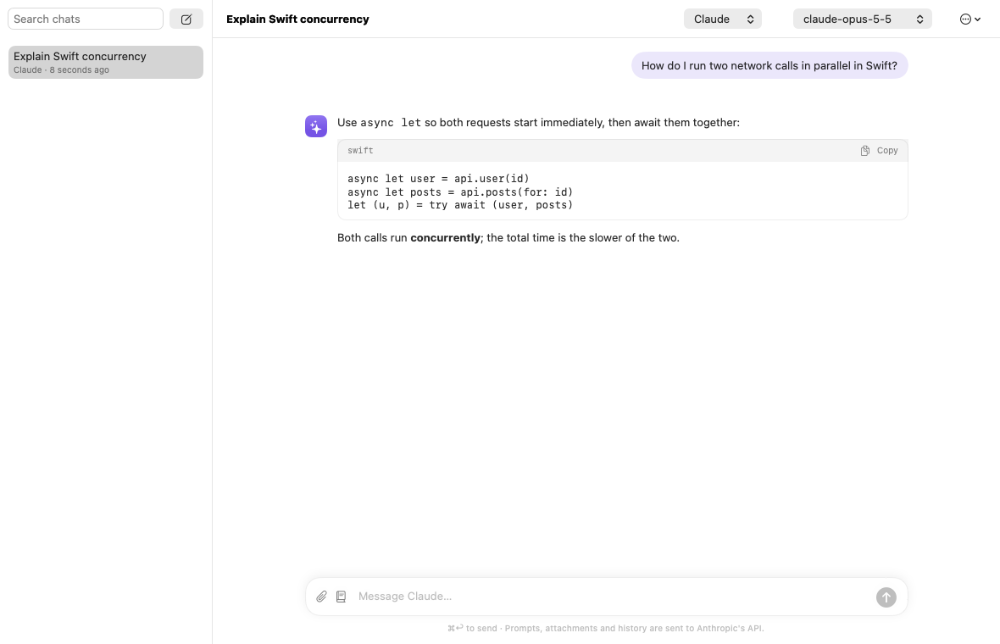
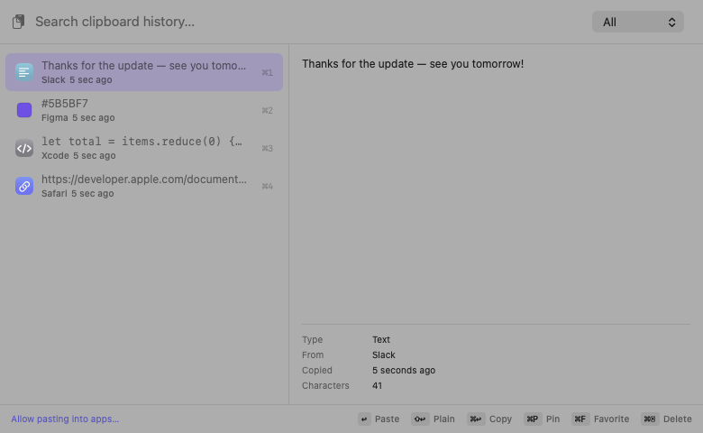
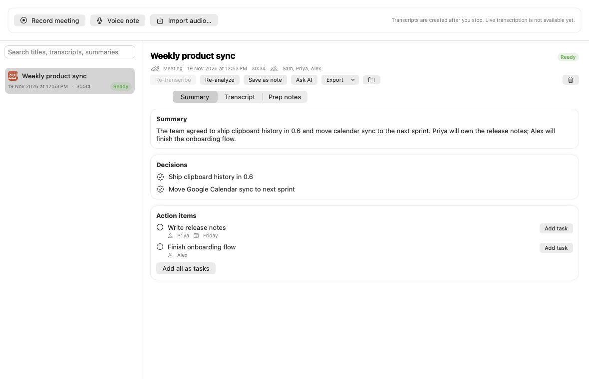

# MacPilot

Your personal AI-powered workspace for macOS: a native menu bar app with a floating assistant, a full dashboard, global shortcuts, and bring-your-own-key access to Claude and OpenAI (plus local models through Ollama). Everything is stored locally; API keys live in the macOS Keychain.

## Status

| Phase | Scope | Status |
|---|---|---|
| 1 | Native app, menu bar, dashboard, shortcuts, settings, Keychain | Done |
| 2 | OpenAI + Claude streaming chat, history, prompt library | Done (plus Ollama) |
| 3 | Microphone recording, dictation, transcription, transcript editor | Recording, import, transcription and editor done; push-to-talk dictation next |
| 4 | Meeting recording, system audio, speakers, meeting intelligence | Done (live transcription not yet) |
| 5 | Calendar, notes, tasks, reminders | Done (Apple Reminders sync not yet) |
| 6 | Clipboard manager, developer workspace | Done (plus ⌥K command launcher) |
| 7 | Automations, local Whisper, distribution | Planned |

## Screenshots

| Dashboard | Assistant |
|---|---|
|  |  |
| **Calendar (week)** | **⌥C clipboard panel** |
|  |  |
| **Recordings** | **Dark mode** |
|  |  |

Rendered offscreen with sample data (`SNAPSHOT_DIR=docs/screenshots/new swift test --filter UISnapshots`), so window chrome and blur are not shown. Earlier versions are in `docs/screenshots/before/`.

## Requirements

- macOS 14 Sonoma or later (Apple silicon or Intel)
- Xcode 15.3+ or the matching Command Line Tools (Swift 5.10+)

## Build and run

```bash
./scripts/build-app.sh          # release build -> build/MacPilot.app
open build/MacPilot.app
```

You can also open `Package.swift` in Xcode and run the `MacPilot` scheme for debugging. Running the bare binary (`swift run`) works too, but task notifications are disabled outside a bundled `.app`.

Tests: `swift test`

On first launch the dashboard opens on **Settings → Providers**. Paste your Anthropic and/or OpenAI key, press **Save**, and MacPilot tests the connection and loads the model list.

### Installing on another Mac

1. On this Mac run `scripts/package.sh`. It builds a universal app (Apple silicon and Intel, macOS 14+) and writes `build/MacPilot-<version>.zip` and `.dmg`. Send the zip or dmg, not the bare `.app` folder: copying the folder through some apps strips permissions and macOS then calls it "damaged".
2. On the other Mac, unzip (or open the dmg) and drag **MacPilot** into **Applications**.
3. The default build is not signed with an Apple Developer ID, so macOS blocks the first launch. Allow it once, either:
   - double-click MacPilot, then **System Settings → Privacy & Security**, scroll down and press **Open Anyway**; or
   - in Terminal: `xattr -dr com.apple.quarantine /Applications/MacPilot.app`
4. Open MacPilot. It lives in the menu bar (paper-plane icon); there is no Dock icon until you open the dashboard.

For installs that open with no warning, sign with a Developer ID certificate (paid Apple Developer Program) and notarize:

```bash
xcrun notarytool store-credentials macpilot --apple-id you@example.com --team-id TEAMID
SIGN_IDENTITY="Developer ID Application: Your Name (TEAMID)" NOTARY_PROFILE=macpilot scripts/package.sh
```

### Keychain prompts

The build script signs ad hoc by default, so macOS may ask for Keychain access again after each rebuild. To avoid that, sign with your own identity:

```bash
SIGN_IDENTITY="Apple Development: Your Name (TEAMID)" ./scripts/build-app.sh
```

## Default shortcuts

| Shortcut | Action |
|---|---|
| ⌥Space | Floating AI assistant |
| ⌥D | Voice dictation (opens Voice until push-to-talk ships) |
| ⌥R | Start / stop a meeting recording (named after the current calendar event) |
| ⌥C | Clipboard history panel (search, paste into the current app) |
| ⌥N | New note |
| ⌥T | New task |
| ⌥K | Command launcher: commands, notes, tasks, clipboard, apps, “Ask AI” |

All shortcuts can be changed in **Settings → Shortcuts**. Some macOS versions refuse global shortcuts that use only ⌥ (or ⌥⇧); if that happens, Settings shows the error and you can add ⌃ or ⌘.

## Recording and meetings

- **Voice & Transcription** records voice notes (microphone) and imports audio files (MP3, WAV, M4A, FLAC, OGG, AAC). Pick the microphone in **Settings → Recording & Calendar**; pause, resume and a level meter are in the recording bar and the menu bar.
- **Meetings** (⌥R, or **Record** on a calendar event) record the microphone as “Me” and, with Screen & System Audio Recording permission, system audio as “Others” in a separate track via ScreenCaptureKit. Without that permission MacPilot keeps recording the microphone and says so.
- After you stop, the audio is transcribed with OpenAI (`/v1/audio/transcriptions`, model from **Routing**; long files go up in 2-minute pieces) and analyzed by the analysis provider: summary, decisions, action items with owner and due date, deadlines, open questions and a follow-up email. Turn the automatic run off in Settings to trigger each step yourself.
- The transcript editor plays both tracks together; click a timestamp to seek, edit any line, rename speakers, search, and export Markdown, TXT or SRT. Action items become tasks (category “Meeting”); **Save as note** and **Ask AI** reuse the transcript.
- Audio lives in `~/Library/Application Support/MacPilot/Recordings/`; set a retention period in **Privacy & Data**. Live transcription and local Whisper are not available yet.

## Calendar

- **Calendar & Meetings** reads Apple Calendar through EventKit (full access, asked once): day, week and month views, calendar filters, conflict highlighting, and tasks due each day.
- Create, edit and delete events with an alert. **Quick add** (“Lunch with Sam Friday 1pm”) is read by the analysis provider (or by macOS date detection if no provider is available) and always opens the editor so you confirm before anything is saved.
- **Google Calendar (optional):** in **Settings → Recording & Calendar**, paste the client ID and secret of a Google Cloud OAuth client of type *Desktop app* (Google Calendar API enabled), press **Connect** and approve in your browser. Google calendars then appear next to Apple ones (marked with a G), with the same views, conflict checks, quick add, Record and Prep notes. Sign-in uses PKCE with a loopback redirect; the refresh token and client secret stay in the Keychain. Alternatively add the Google account under System Settings → Internet Accounts and it shows up through Apple Calendar.
- Each event has **Record** (a meeting linked to the event, with its attendees) and **Prep notes** (a note linked to the event; its text is included when the meeting is analyzed). The dashboard shows upcoming meetings with a live countdown.

## Clipboard history (Raycast-style)

- MacPilot saves what you copy: text, rich text, links, files, colors and (optionally) images, with the app it came from. Copying the same thing again moves it to the top instead of duplicating it.
- **⌥C** opens a floating panel over the app you are in: type to fuzzy-search, ↑/↓ to move, **Return** pastes into that app, **⇧Return** pastes as plain text, **⌘Return** only copies, **⌘1–⌘9** quick-paste, **⌘P** pin, **⌘F** favorite, **⌘⌫** delete, **Tab** cycles filters (Text, Links, Images, Code, Files, Favorites, Pinned), **Esc** closes.
- Pasting into other apps needs **Accessibility** permission (System Settings → Privacy & Security → Accessibility). Without it, Return copies and you press ⌘V.
- Never saved: items marked concealed/transient by password managers, copies from excluded apps (1Password, Bitwarden, Keychain Access, Passwords, LastPass, Dashlane by default) and anything that looks like an API key, token, private key or card number. Pause capture from the menu bar.
- The **Clipboard** section has the full history with folders, pins, favorites, retention (1 day–unlimited, max items) and AI actions: Explain, Summarize, Fix grammar, Translate, Format JSON.

## Command launcher

**⌥K** searches MacPilot commands (new note/task/event, record, open any section, pause clipboard), your notes, open tasks, clipboard items and installed apps. Typing text offers “Ask AI”, “Add task: …” and “Add event: …” (the event still opens the editor for confirmation). Return runs, ⌘Return runs the secondary action.

## Developer workspace

- **Repositories:** add folders; see branch, ahead/behind, changes (`git status --porcelain=v2`), recent commits, switch branch, stage all and commit with an AI-written message. Open in VS Code, Terminal or Finder.
- **AI tools:** explain an error, review code, generate tests, explain code (paste or use the staged diff), and write a PR summary from the branch's commits.
- **Terminal:** saved commands per repository and one-off commands. Every run shows the exact command and folder for confirmation; commands that delete, overwrite, force-push, use sudo and similar need a second “I understand”. Output streams live with a Stop button; history is kept with secrets removed.
- **API:** request builder with method, URL, headers and body, response status, time, headers and pretty JSON; saved requests never store Authorization, Cookie or API-key header values.
- **JSON:** format, minify, validate, sort keys.

## Architecture

```
Sources/MacPilot
├── App/          App entry, AppState, window/panel management, global hotkeys (Carbon)
├── AI/           Provider protocol, Anthropic / OpenAI / Ollama streaming clients, router, usage limits
├── Models/       SwiftData models (Conversation, ChatMessage, PromptTemplate, Note, TaskItem, Recording) and the store
├── Services/     Keychain, preferences, export/delete, notifications, transcription, meeting intelligence, EventKit
│   ├── Audio/    Microphone (AVCaptureSession) and system audio (ScreenCaptureKit) recorders, RecordingManager
│   ├── Clipboard/ Pasteboard monitor, sensitive-content filter, paste service, fuzzy matcher, clip AI actions
│   └── Developer/ git (porcelain v2), argument-array process runner, command safety, HTTP request runner
└── Views/        Dashboard, Assistant, Quick assistant, Voice, Calendar & Meetings, Notes, Tasks, Settings, menu bar
```

- **Providers are independent** (PRD section 5): chat, transcript analysis and transcription each have their own setting in **Settings → Routing**.
- **Claude** uses the Messages API with streaming over raw HTTP (there is no official Swift SDK). The default model is `claude-opus-5-5`. For models that support it, requests opt into the server-side refusal fallback (`anthropic-beta: server-side-fallback-2026-07-01`, `fallbacks: "default"`), so a safety refusal is retried on a suitable model instead of failing.
- **OpenAI** uses Chat Completions streaming. The default model is `gpt-5`; change it or pick from the live list after **Test connection**.
- **Secrets**: keys are read from the Keychain at request time, never stored in SwiftData or UserDefaults, and provider error messages are passed through a redactor before they are shown.
- **Usage limits**: token usage per provider per month is tracked from provider responses; set a monthly token cap in **Settings → Usage**.
- **No backend**: data lives in `~/Library/Application Support/MacPilot/`. Export everything as JSON or delete it from **Settings → Privacy & Data**.

## Not yet verified

The transcription model names in the PRD (`gpt-transcribe`, `gpt-live-transcribe`) were not verifiable when this was written, so Routing defaults to `gpt-4o-transcribe`; the fields are editable.
